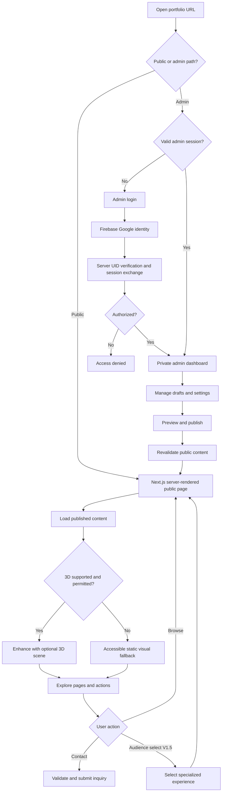
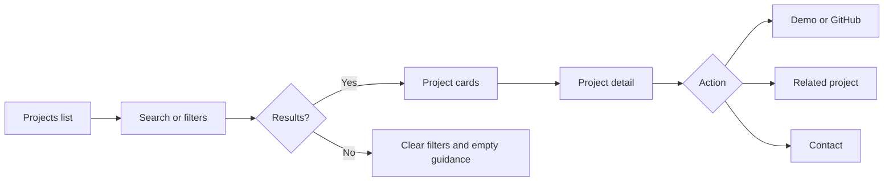
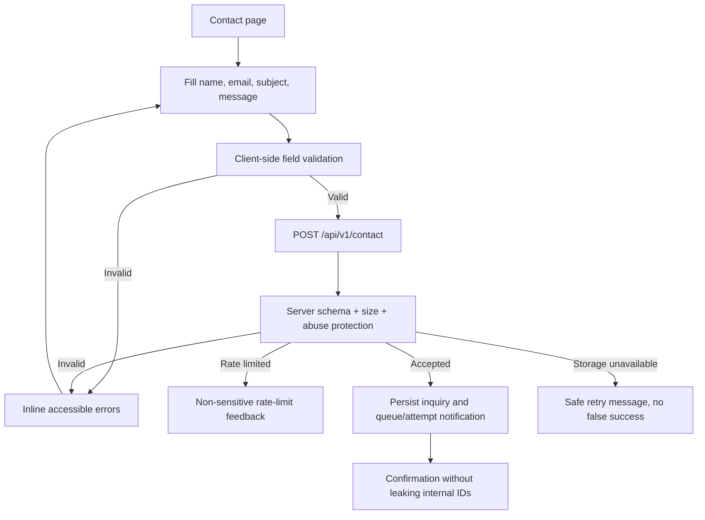
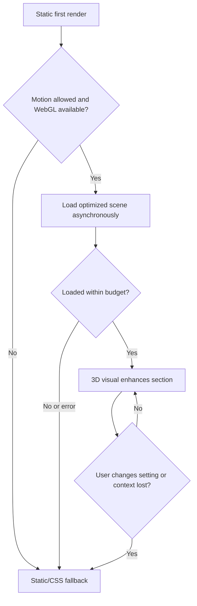
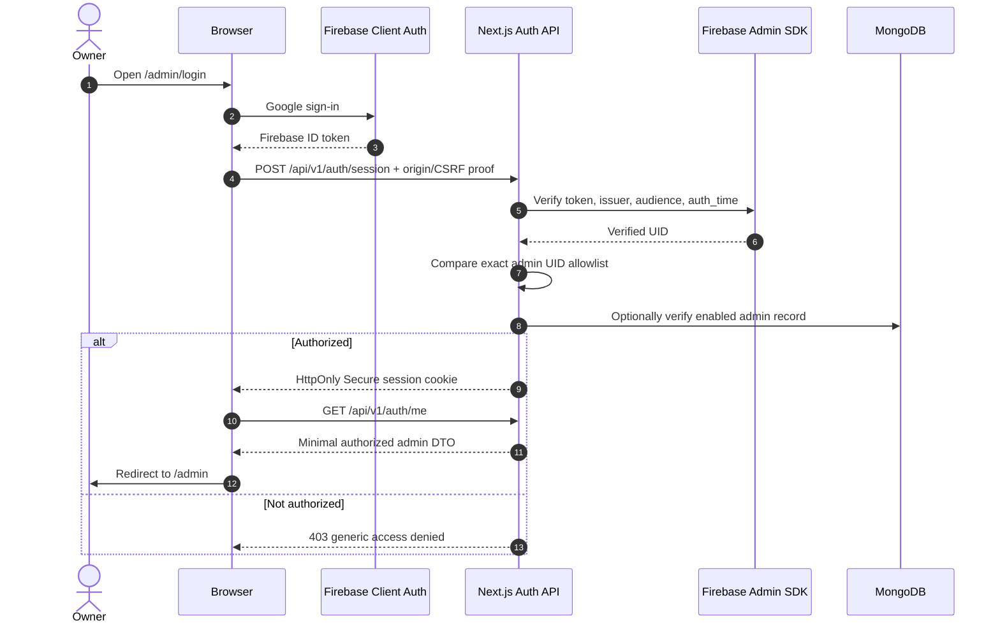
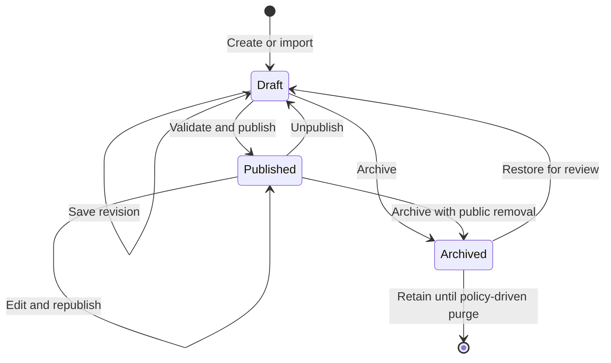
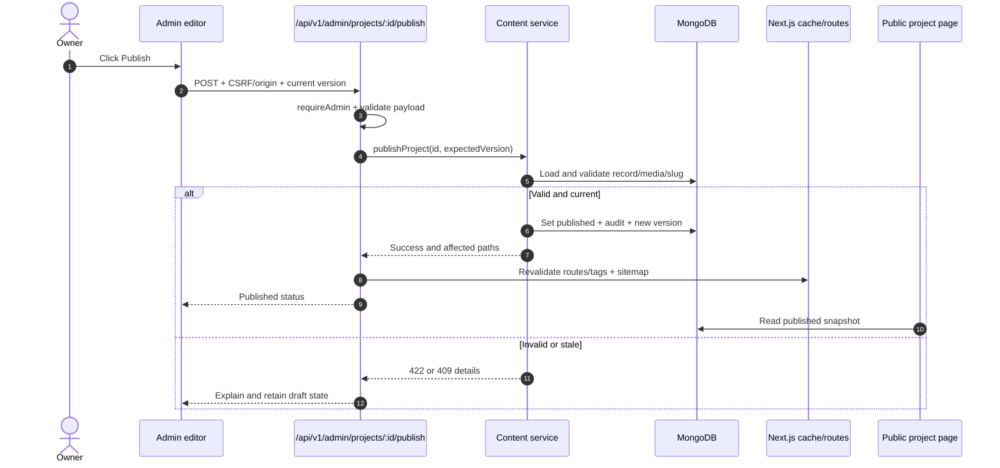
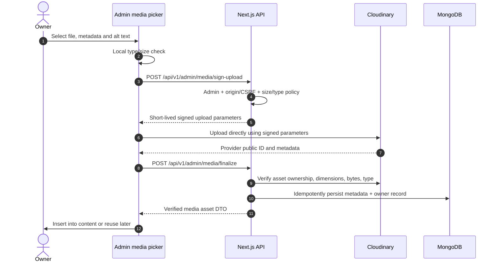
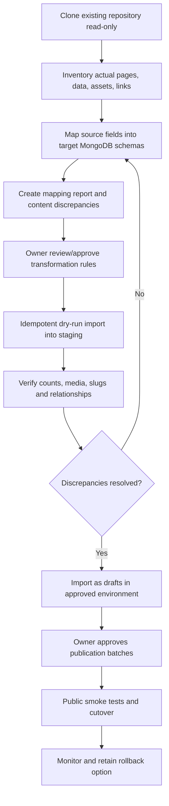

# Dynamic 3D Portfolio & Personal CMS — Application Flow Document

**Document ID:** PORTFOLIO-AFD-001  
**Version:** 1.0  
**Date:** 2026-10-13  
**Status:** Proposed implementation baseline; verify against repository during Phase 0  
**Owner:** Md. Sabbir Hossen  
**Companion documents:** `3D_Portfolio_Production_PRD.md` (PRD v1.0); `3D_Portfolio_Technical_Requirements_Document_TRD.md` (TRD v1.0)  
**Architecture:** Next.js App Router + TypeScript + MongoDB/Mongoose + Firebase Auth + Cloudinary + React Three Fiber + Vercel  
**Experience:** Balanced, editorial 2D UI with selective progressive 3D  
**Delivery:** Phased MVP → V1.5 → V2, migration from existing React/Vite portfolio

> **Status disclaimer:** This document specifies intended application behavior, not existing implemented functionality. Phase 0 must inspect the original code, records, links, and media. The PRD owns product scope; the TRD owns technical contracts; this App Flow document owns screen transitions, user actions, states, and interaction sequences. If these disagree, log an ADR and reconcile before coding.

---

## 1. Flow map and actors

### 1.1 Actors and permissions

| Actor | Authentication | Allowed actions | Disallowed actions |
|---|---|---|---|
| Anonymous visitor | None | Read published content; filter/search; download public resume; submit limited contact inquiry | Read drafts, admin data, private messages, or mutate content |
| Recruiter/client/developer/researcher/general visitor | None | Same visitor permissions with tailored content ordering (V1.5) | Privileged access or inferred permanent identity |
| Owner/admin | Firebase Google login + server-verified admin UID + secure session | View admin, manage content/assets/messages/settings, publish and unpublish | Bypass validation, authorization or audit |
| Unauthorized signed-in Google user | Firebase login may succeed | View public content; receive generic access-denied state | Create admin session or access admin APIs |
| External services | Credentials scoped to server/integration | Return GitHub metadata, media delivery, errors and analytics where enabled | Authoritative editing of content unless verified, approved integration flow |

**Global invariants:** public queries return *published and visible* records only; admin reads/mutations require a fresh verified server-side authorization check; 3D is never the only means of navigation; visitors do not register; content updates do not require a code deployment.

### 1.2 Overall application navigation



### 1.3 Release markers

- **[MVP]** Mandatory before initial production release.
- **[V1.5]** Secondary functionality after stable MVP.
- **[V2]** Advanced optional capabilities.

---

## 2. Public route → page → action map

| Route | Release | Entry path | Primary screen regions | Main actions | Destination |
|---|---|---|---|---|---|
| `/` | MVP | Direct / logo / Home | Hero, intro, featured work, CTAs, optional 3D | Explore projects, resume, contact | `/projects`, `/resume`, `/contact` |
| `/about` | MVP | Nav, hero | Bio, values, story, social links | Explore experience, education | `/experience`, `/education` |
| `/projects` | MVP | Nav, home CTA | Filter/search, project grid/list, empty state | Open case study, repo/demo | `/projects/[slug]` or trusted external URL |
| `/projects/[slug]` | MVP | Project card, direct link | Overview, problem, approach, media, outcomes, stack, related | Visit live/GitHub, related project, contact | External links, `/contact`, other details |
| `/skills` | MVP | Nav, about | Skill categories, project evidence | Open evidence project | `/projects/[slug]` |
| `/experience` | MVP | Nav, about | Role chronology, outcomes | Follow project/organization references | Project or trusted external URL |
| `/education` | MVP | Nav, about | Academic timeline | Open verified references | Public links where available |
| `/certifications` | MVP | Nav | Filterable credential gallery | Open credential detail | `/certifications/[slug]` |
| `/certifications/[slug]` | MVP | Certificate card | Issuer, dates, description, credential media | Verify public link, view permitted file | Verified external URL/media |
| `/resume` | MVP | Header, recruiter CTA | HTML overview, download CTA | Download maintained PDF, contact | PDF, `/contact` |
| `/contact` | MVP | Global CTA, footer | Contact methods, consent notice, validated form | Submit inquiry | Same page confirmation |
| `/privacy` | MVP | Footer | Handling of analytics/contact data | Read policy | Same page |
| `/for/recruiters` | V1.5 | Audience selector / link | Resume, skills, proof, contact | Download resume, view case studies | Public pages |
| `/for/clients` | V1.5 | Audience selector / link | Services, outcomes, portfolio, inquiry | Submit inquiry | `/contact` |
| `/for/developers` | V1.5 | Audience selector / link | Stack, GitHub, engineering narratives | Visit code / article | Repo, projects/blog |
| `/for/researchers` | V1.5 | Audience selector / link | Research, education, collaboration | Open publications, contact | `/research`, `/contact` |
| `/for/visitors` | V1.5 | Audience selector / link | Story, timeline, broad discovery | Explore sections | Public pages |
| `/blog`, `/blog/[slug]` | V1.5 | Nav/featured article | Listing, article, related entries | Read/share | Public pages |
| `/research`, `/research/[slug]` | V1.5 | Nav/audience | Verified work and interests | View paper/DOI/contact | Detail or external URL |
| `/timeline`, `/achievements`, `/uses`, `/now`, `/links` | V1.5 | Nav/links | Structured records | Explore linked items | Public pages |
| `/guestbook` | V2 optional | Explicit nav item | Moderated contributions | Submit only if enabled | Confirmation/moderation |

All public routes have semantic loading, not-found, error, empty and offline-tolerant states where applicable. Every page has a meaningful title, accessible heading structure, canonical metadata and navigation that works without WebGL.

---

## 3. Visitor entry and homepage flow [MVP]

**Journey ID:** FLOW-PUB-001. **Goal:** visitor understands who the owner is and can reach evidence or contact within a few interactions.

```mermaid
flowchart TD
    A[Direct visit, search, social link] --> B[Server-render homepage]
    B --> C[Show real identity, tagline, CTA]
    C --> D{WebGL and motion permitted?}
    D -->|Yes| E[Lazy mount lightweight hero scene]
    D -->|No or failure| F[Static hero artwork or CSS visual]
    E --> G[Visitor chooses CTA]
    F --> G
    G -->|View work| H[/projects]
    G -->|Resume| I[/resume]
    G -->|Contact| J[/contact]
    G -->|Other navigation| K[Public route]
```

**Behavior:** SSR HTML renders name, intro, project links, and primary CTAs before optional scene hydration. Scene failure must not obscure or shift CTA controls. Theme defaults to system preference until user overrides it; all transitions honor reduced motion.

**Empty/error states:** featured projects absent → show meaningful professional intro and links instead of placeholder metrics; scene load error → suppress scene and display static fallback; unexpected content read error → page-level safe fallback with retry/navigation, no stack trace.

**Acceptance:** keyboard user can access core CTAs; server HTML contains meaningful content; 3D disabled does not remove information; no unverified achievements or fictitious numbers.

---

## 4. Project discovery and case-study flow [MVP]

**FLOW-PUB-002**

1. Visitor opens `/projects`, sees published entries only, most relevant/featured ordering with stable pagination.
2. Visitor types a query or selects a category/skill; query state is reflected in URL where feasible for shareability.
3. UI shows loading transition, matching cards and result count without unexpected focus reset.
4. Visitor selects card; route `/projects/[slug]` loads from server by *published* slug.
5. Page shows verified project narrative, media, technology evidence, live/repository links, and related projects.
6. Public external links use safe target/rel and preserve accessible labels.
7. Missing, draft, unpublished, archived or malformed slug → public 404; changed slug → configured permanent redirect when approved.



**Special cases:** no screenshot → styled content-first placeholder without fabricated art; untrusted/invalid external URL → prevent display or rendering; removed project → 404 or intentional redirect; slow external GitHub API → cached CMS content remains available.

---

## 5. Certification, resume and contact journeys [MVP]

### 5.1 Certification flow — FLOW-PUB-003

`/certifications` → apply category/filter → select card → `/certifications/[slug]` → read issuer/date/credential metadata → select approved verification link or permitted PDF/image → return to list. Private credential files or unpublished records never appear through guessable public URLs. Expired certificates display truthful validity state instead of being silently altered.

### 5.2 Resume flow — FLOW-PUB-004

Global resume CTA → `/resume` with accessible HTML overview → choose `Download PDF` → browser downloads currently published resume asset. If public PDF is not configured, disable the button with clear explanation and keep HTML overview available. Resume links and content must be synchronized with admin settings, not hardcoded.

### 5.3 Contact flow — FLOW-PUB-005



**Safety requirements:** no public inbox endpoint; no account creation; explicit privacy/consent text as applicable; honeypot or equivalent anti-spam + server rate limiting; notification failure must be monitored separately from successful persisted inquiry. Do not display sender email in public analytics or logs.

---

## 6. Audience-selection and personalization [V1.5]

**FLOW-PUB-006:** nav audience selector → user chooses recruiter/client/developer/researcher/general visitor → render matching `/for/...` page using *the same approved content records* ordered differently → visitor can switch mode or navigate normal routes. Store only explicit mode preference in browser (subject to chosen privacy approach); no role inference from browser fingerprinting or silent identity profiling. URLs remain shareable and SEO policy must avoid duplicate index content through canonicals/unique page value.

| Selected mode | Hero emphasis | Ordered evidence | Final CTA |
|---|---|---|---|
| Recruiter | Professional role and availability if verified | Resume → skills → projects → experience | Download resume / contact |
| Client | Services and delivery outcomes | Case studies → service fit → process | Project inquiry |
| Developer | Code quality and engineering choices | Projects → stack → GitHub → articles | Explore repository |
| Researcher | Academics and research interests | Research → education → publications | Collaborate |
| Visitor | Professional journey | Story → projects → timeline | Explore / contact |

**Fallback:** missing personalized content → hide empty section and show stable global sections; switching mode must not alter DB visibility or create personalized copies of records.

---

## 7. 3D progressive enhancement and accessibility flow [MVP baseline; V1.5 expansion]

**FLOW-VIS-001:** server sends semantic HTML and reserved visual container → check feature support, reduced-motion preference, device budget and optional user 3D toggle → lazy-load model and React Three Fiber scene → render at capped rendering demand → allow keyboard/accessible alternate controls where scene carries actions → gracefully recover from GL context loss/load errors.



Rules: controls must not live exclusively in a canvas; no mandatory scroll hijacking; use accessible HTML equivalents; load compressed GLB/glTF with optimized geometry/textures; stop offscreen animation; avoid excessive hydration; 3D never blocks form submissions or page navigation. Mobile and reduced-motion presentations use lighter/no animation without losing content.

---

## 8. Admin entry, authentication and session flow [MVP]

**FLOW-AUTH-001**



**Session requirements:** server checks secure cookie on `/admin` layout render and every `/api/v1/admin/*` request; `__Host-` production cookie if compatible with chosen cookie scope; cookie secure/httpOnly/SameSite and bounded TTL; defense against login CSRF, fixation, mutation CSRF and stolen/revoked tokens. Use strict single-owner UID allowlist; email string alone is not proof of admin authority.

**FLOW-AUTH-002, returning admin:** `/admin/...` → server verifies session → allow intended page; absent/expired → redirect to `/admin/login?next=<validated-internal-path>`; after successful authentication return to validated admin path. Reject external redirect targets.

**FLOW-AUTH-003, logout:** admin menu → logout confirmation if desired → `POST /api/v1/auth/logout` with origin/CSRF proof → clear cookie and optionally revoke wider session → redirect to public homepage or login → back navigation cannot reveal protected server data.

**Security error matrix:** invalid UID 403; missing session 401/redirect; stale session 401; Firebase unavailable → safe retry, no bypass; authorization failure → audit event without tokens; rate limited exchange → 429; contact/admin error descriptions never expose secrets.

---

## 9. Admin shell, dashboard and navigation [MVP]

**FLOW-ADM-001:** authorized `/admin` → persistent sidebar/top bar → server-served dashboard summary (real counts only) → quick actions (Add project, Add certificate, Upload media, View messages) → navigate to management page → return via sidebar/breadcrumb.

Admin shell components: brand; global content search if built; primary navigation; account menu; active page indicator; notifications of save/publish outcome; responsive collapsible sidebar; session-expiry handling; loading skeletons; access-aware 404/error screens. Dashboards may display project counts by status, message counts, last publish time and storage warnings—but not invented traffic or placeholder data passed as live data.

| Dashboard interaction | Destination | User outcome |
|---|---|---|
| Add project | `/admin/projects/new` | Editable new draft |
| Manage certificates | `/admin/certifications` | List, search, edit, publish per verified contract |
| Media library | `/admin/media` | Upload/select/reuse files |
| Unread inquiries | `/admin/messages` | Read, label/status, delete per retention policy |
| Profile/settings | `/admin/profile`, `/admin/settings` | Maintain public identity/global configuration |
| View site | `/` | Public site in new tab or safe navigation |
| Logout | Auth logout flow | Server session ended |

---

## 10. Shared CMS workflow and publication state machine [MVP]

### 10.1 Record lifecycle — FLOW-CMS-001



**Interpretation:** `draft`, `published`, `archived` are the authoritative externally visible states. Editing a published item should not accidentally expose unreviewed changes; implement either (a) explicit draft revision / publish snapshot or (b) a documented edit-and-republish policy preserving public content until approval. The TRD's data version/concurrency and publish validation rules prevail. Scheduled publishing is V2 and must not be half-implemented in MVP.

### 10.2 Generic create/edit flow — FLOW-CMS-002

1. Owner selects `New` on a module list. Form loads with validated defaults, no fake records.
2. Owner enters fields and chooses media from library/upload; client validates for quick feedback.
3. Owner selects `Save draft`; API repeats server validation and enforces ownership/admin role.
4. Service persists draft, increments revision/version and writes audit entry.
5. Response supplies record ID, updated timestamp/version, and status; UI shows saved state.
6. Owner changes fields, previews, and requests publication; server performs stricter publish checks.
7. Publish completes transactionally where required, records event, invalidates affected routes/sitemap and returns status.
8. Public page now displays published snapshot; direct admin-only preview remains private.

**Failure states:** 400/422 validation → field errors, retain values; 401/403 → exit/re-auth; 409 stale version → compare/reload before overwrite; 413/415 file problems → reject with explanation; 429 abuse limit → retry guidance; 500 → preserve local unsaved form and show retry. Discarding dirty form requires confirmation. No automatic secret-bearing retry loops.

### 10.3 Publication sequence — FLOW-CMS-003



**Unpublish:** explicit confirm → `/api/v1/admin/projects/:id/unpublish` → enforce authorization → change status → revalidate project/list/home/sitemap/search → public detail responds 404 (or deliberate redirect policy), caches must not continue exposing stale content.

### 10.4 Generic management list

`/admin/{module}` → authenticated fetch of all permissible statuses → search/filter/sort/paginate → `New`, `Edit`, `Duplicate` where supported, `Preview`, `Publish/Unpublish`, `Archive` → confirmed state transition → refreshed list; retain filters/navigation state when returning from editor.

---

## 11. Project creation and showcase lifecycle [MVP]

**FLOW-ADM-002:** dashboard → `/admin/projects` → `New Project` → `/admin/projects/new` → fill essentials (title, unique slug, summary, category, technology, links, narrative) → upload/select cover/screenshots → `Save Draft` → preview → `Publish` → visit `/projects/[slug]` → verify searchable/project card/SEO. API conventions:

- `GET/POST /api/v1/admin/projects`
- `GET/PATCH/DELETE /api/v1/admin/projects/:id`
- `POST /api/v1/admin/projects/:id/publish`
- `POST /api/v1/admin/projects/:id/unpublish`
- `POST /api/v1/admin/projects/:id/duplicate`
- public `GET /api/v1/public/projects` and `GET /api/v1/public/projects/:slug`

**Project editor tabs:** Overview; Narrative/Case Study; Tech Stack and Tags; Media; Links; SEO and Visibility; Preview (tabs may collapse to sections on smaller screens).

**Validation:** unique slug; required publish fields; safe URLs; linked skills/media must exist and be public-safe; gallery alt text; cover fallback; no direct storage URL injection; structured link types; version concurrency. A GitHub repo link can coexist with manual case-study data and never overwrites owner-written content.

**Published edit policy:** preserve last published content until republish approval; publish updates should trigger home/project/list and metadata invalidation. If implementing edit-in-place instead, document approved ADR and corresponding user-facing warning and test.

---

## 12. Certification, skills, education, experience and resume admin [MVP]

### 12.1 Certifications — FLOW-ADM-003

`/admin/certifications` → `New` → issuer, title, dates, ID/verification URL, skills, media, category → save draft → verify credential/file privacy → preview → publish via **explicitly specified route after ADR/OpenAPI amendment** → `/certifications/[slug]` available. Since TRD notes a missing dedicated certificate publish endpoint, do **not** silently invent a public endpoint; resolve before implementation. Missing verification URL may be allowed if honest metadata and release rules permit, but never fabricate credential verification.

### 12.2 Skills — FLOW-ADM-004

`/admin/skills` → create/edit skill name/category/order/visibility → optionally relate verified published projects → save → public `/skills` refresh. A numeric proficiency score is optional, not required; evidence links are preferred over arbitrary percentages. Deleting referenced skills should either block or explicitly detach in a controlled audited operation.

### 12.3 Experience and education — FLOW-ADM-005

`/admin/experience` or `/admin/education` → edit structured organization, title/degree, start/end, description, location/public links → validate date ranges and current-role conditions → save/update ordering → public chronology refresh. Never display confidential institution/person information or unverified claims by default.

### 12.4 Resume — FLOW-ADM-006

`/admin/resume` → view currently published resume and last updated date → choose approved PDF asset, edit public HTML summary and corresponding links → preview → save/publish as supported by model → `/resume` and CTA download reflect version. Avoid generating a PDF unless implemented and verified; MVP can manage uploaded PDF. Missing PDF should not break HTML resume.

### 12.5 Profile and global settings — FLOW-ADM-007

`/admin/profile` → name, tagline, location disclosure choice, bio, socials → validate/public preview → save → homepage/about/meta refresh. `/admin/settings` → theme/feature flags/contact destinations/SEO defaults → validate allowed URLs and safe values → save/audit → affected route cache revalidation. Editing profile must not permit changing admin UID through public DTO.

---

## 13. Media upload, reuse, replacement and cleanup [MVP]

**FLOW-MEDIA-001**



Media manager states: queued → validating → uploading(progress) → uploaded/unfinalized → verifying → ready, or failed/canceled. Orphaned assets are queued for bounded cleanup after verification. MIME, file size, filename and signed metadata must be checked server-side/provider-side; never trust client-provided CDN URLs as proof of ownership. Supported variants and quotas must be configured separately for images, PDFs, video and 3D assets. Delete should be blocked when actively referenced or ask for a safe replacement before removal; never destroy assets still used by published pages.

**FLOW-MEDIA-002 replacement:** choose existing asset → upload replacement → verify new asset → update references under safe content revision → revalidate → mark prior asset reclaimable only when no references remain.

---

## 14. Messages and inquiry administration [MVP]

**FLOW-ADM-008:** public form submit → server validates and persists private inquiry → admin dashboard count changes → `/admin/messages` → list (sender, subject, date, status; minimize PII) → open detail → mark `read`, `follow_up`, `resolved` as supported → optionally use a reply-by-email link (not claimed to be in-app sending unless implemented) → delete per policy with confirmation. Spam/abuse prevention applies to public creation. Admin GET must be uncached private data; never include messages in static generation, telemetry payloads, or public APIs.

---

## 15. Preview, drafts, revisions and audit [MVP / V1.5]

**FLOW-ADM-009:** editor → `Preview` → server creates authenticated owner-only preview session or a tightly scoped short-lived token → read draft privately in public-style rendering → `noindex`, no public caching, no sitemap → return to editor. Draft and preview response must never be exposed through a plain public route or cache-sharing bug.

**Revision handling:** basic concurrency/version checks MVP; full content revision history and restore V1.5. Stale form save → 409 with safe messaging; do not silently overwrite a newer revision. Audit history logs actor, action, entity ID, timestamp, outcome and safe diff metadata, redacting tokens, PII and sensitive URLs.

---

## 16. V1.5 content expansion and external integrations

| Flow | Trigger | Steps | Failure behavior |
|---|---|---|---|
| Blog authoring | `/admin/blog` | Create → rich text/Markdown → sanitize → draft → preview → publish → `/blog/[slug]` | Invalid HTML rejected; drafts excluded from public |
| Research entries | `/admin/research` | Record research interest/project/publication → verify DOI/link → publish → `/research/[slug]` | No fabricated bibliography |
| Timeline | `/admin/timeline` | Add dated event → connect project/education → publish → semantic list and optional 3D | 3D failure retains list |
| Testimonials | `/admin/testimonials` | Verify attribution/consent → review → publish | Unapproved contributions never public |
| Navigation/pages | `/admin/navigation`, `/admin/pages` | Reorder/enable approved entries or blocks → preview → publish | No unsafe arbitrary script/HTML |
| Advanced SEO | `/admin/seo` | Edit validated metadata and redirects → preview → revalidate | Detect redirect loops/conflicts |
| GitHub sync | Admin integrations UI | Connect authorized repository metadata source → fetch → review diff → approve selected fields | Outage uses cached local content; no automatic claim rewrite |
| Analytics | `/admin/analytics` | Query consent-compliant aggregated analytics | Empty state if no data; never fake counts |
| Content search | Header/command palette | Search approved public indexed content → results → detail | Empty feedback; no draft leakage |

Scheduled publishing, AI chat grounded in approved records, multilingual routes, deeper 3D spaces, and guestbook moderation are V2 and must not delay initial launch.

---

## 17. Migration flow from current React/Vite portfolio [MVP]

**FLOW-MIG-001:** do not start with data deletion or direct live import.



**Migration rules:** never assume current data model; preserve original names/dates/links; record source references and mapping version; use deterministic import keys to prevent duplicates; preserve originals/backups; imported material defaults to draft; do not auto-publish dubious certificates/claims; maintain approved redirects from old project URLs when needed. Rollback restores previous deployment/configuration without destructive DB rollback assumptions. Compare actual migrated counts and manual spot checks before launch.

---

## 18. Client/server dataflow and cache model

```mermaid
flowchart LR
    A[Public route Server Component] --> B[Public content service]
    B --> C[(MongoDB)]
    B --> D[Published-only DTO]
    D --> A
    E[Admin form] --> F[/api/v1/admin/*]
    F --> G[Auth + validation + business service]
    G --> C
    G --> H[Audit + path/tag revalidation]
    H --> A
    I[Optional R3F component] -. lazy hydrates .-> A
    J[Cloudinary CDN] -. optimized media .-> A
```

**Caching:** public pages may use tag/path-based revalidation. On publish/edit/unpublish, invalidate list, detail, featured/home, metadata, sitemap and related pages as appropriate. Always treat status as authoritative in server query, not only cache state. Admin pages, previews, sessions, messages and private files require no-store/private policies. CDN invalidation and old media reclamation need explicit verified steps.

**Endpoint correspondence:** all API endpoints in Sections 5–16 use TRD's `/api/v1` prefix. Next.js server components may call server services/repositories directly, avoiding self-HTTP roundtrips. Standard API envelopes, bounded pagination, error codes and server DTO allowlists are defined in TRD §6.

---

## 19. Screen state and error-state matrix

| Screen/workflow | Loading | Empty | Error | Success | Unauthorized |
|---|---|---|---|---|---|
| Public projects | Stable skeleton or text | No results + clear filters | Retry, preserve nav | Published cards | Not applicable |
| Project detail | Non-jarring transition | Public 404 | Safe error boundary | Complete case study | Draft treated as 404 |
| Certificates | Filter placeholder | No published records | Retry | Credential detail | Draft treated as 404 |
| Contact | Disable duplicate submit | Blank form | Field errors / rate-limit / retry | Clear submitted confirmation | Not applicable |
| Admin dashboard | Private skeleton | Zero actual records | Retry/diagnostic ID | Metrics and quick actions | Redirect/re-auth |
| Admin editor | Form skeleton | New record defaults | 422/409/500 with unsaved values retained | Saved/draft/published banner | Re-auth + protect local edits |
| Media upload | Progress per file | No files yet | Upload/finalize retry/cleanup | Verified asset card | Reject; no signed parameters |
| Private messages | Private placeholder | No messages | Safe retry | Inbox/details | No data rendered |
| 3D visual | Static fallback first | Static visual | Static visual | Scene as progressive enhancement | Not applicable |
| Migration | Step-level status | Source missing → report | Stop and discrepancy report | Validated draft batch | Privileged only |

Global: not-found offers navigation and search where relevant; 500 boundaries avoid stack traces; forms support focus-managed field errors; destructive actions require confirmation; keyboard and screen-reader paths are first-class.

---

## 20. Screen inventory and reusable components

### 20.1 Public design primitives

`PublicShell`, `SiteHeader`, `MobileNav`, `Footer`, `ThemeSwitcher`, `AudienceSwitcher` (V1.5), `HeroIntro`, `Hero3DIsland`, `StaticHeroFallback`, `ProjectCard`, `ProjectFilters`, `ProjectDetail`, `Tag`, `CertificateCard`, `TimelineList`, `ResumeDownload`, `ContactForm`, `SearchDialog` (V1.5), `EmptyState`, `ErrorBoundary`, `Breadcrumbs`, `SEO metadata`, `SkipLink`, `MotionPreferenceControls`.

### 20.2 Admin design primitives

`AdminShell`, `AdminSidebar`, `AdminHeader`, `SessionGuard`, `StatCard`, `DataTable`, `StatusFilter`, `SearchInput`, `ContentForm`, `RichContentEditor` (V1.5), `MediaPicker`, `UploadQueue`, `PublishControls`, `PreviewLink`, `UnsavedChangesGuard`, `RevisionConflictDialog`, `ConfirmDialog`, `FieldError`, `Toast`, `AuditHistory`, `AdminEmptyState`, `AdminErrorState`.

### 20.3 Responsive behavior

Desktop: stable sidebar and wide content canvas, keyboard shortcuts only as enhancement. Tablet: collapsible sidebar and two-column cards. Mobile: compact navigation and accessible tables/cards; all publishing actions remain available, no admin operation depends on hover. 3D disabled or simplified at constrained viewport/hardware. Preserve color contrast, focus order and reduced-motion behavior in every theme.

---

## 21. Route guards, visibility and SEO decision table

| Request | Session | Record status | Behavior | Indexing/caching |
|---|---|---|---|---|
| Public project slug | None | Published | 200 public page | Indexable; cache per policy |
| Public project slug | None | Draft/archived/missing | 404 or approved redirect | Not indexable |
| Admin edit page | Authorized | Any allowed | 200 private editor | No-store/noindex |
| Admin edit page | Missing session | Any | Login redirect or 401 | No-store/noindex |
| Admin API write | Non-admin Google identity | Any | 403 | No-store |
| Admin preview | Authorized scoped session | Draft/published | Private preview | No-store/noindex |
| Public media | None | Permitted published asset | CDN delivery | Public cache per policy |
| Private document | None | Private | Deny / require signed access | No public cache |
| Public contact POST | None | N/A | Validate, rate-limit, persist | No-store response |
| Search engine sitemap | None | Published only | XML routes | No drafts/admin/preview |

---

## 22. Test journey catalog and traceability

| Flow ID | Core automated/manual assertion | Release |
|---|---|---|
| FLOW-PUB-001 | Home critical content visible without JS/WebGL; working CTAs | MVP |
| FLOW-PUB-002 | Search/filter only published projects; detail 404 for drafts | MVP |
| FLOW-PUB-003 | Credential detail and public verification; draft hidden | MVP |
| FLOW-PUB-004 | PDF CTA serves configured public resume; fallback when absent | MVP |
| FLOW-PUB-005 | Contact valid submit persists; invalid and abuse cases rejected | MVP |
| FLOW-PUB-006 | Explicit audience switch changes presentation not underlying visibility | V1.5 |
| FLOW-VIS-001 | Reduced motion/context loss yields accessible fallback | MVP |
| FLOW-AUTH-001 | Correct UID obtains session; wrong UID denied | MVP |
| FLOW-AUTH-002 | Expired session leads to login; return path safe | MVP |
| FLOW-AUTH-003 | Logout clears session; previous admin data no longer accessible | MVP |
| FLOW-ADM-001 | Dashboard counts are real, admin-only, and links valid | MVP |
| FLOW-CMS-001 | Valid state transitions only; draft never public | MVP |
| FLOW-CMS-002 | Draft save validates; 409 prevents stale overwrites | MVP |
| FLOW-CMS-003 | Publish/unpublish updates detail/list/sitemap without stale leakage | MVP |
| FLOW-ADM-002 | Create/preview/publish project end to end without code changes | MVP |
| FLOW-ADM-003 | Certificate create/edit/preview/publish after endpoint ADR | MVP |
| FLOW-ADM-004 | Skills updates propagate to public view | MVP |
| FLOW-ADM-005 | Education/experience ordering and visibility correct | MVP |
| FLOW-ADM-006 | Resume update changes published download and summary | MVP |
| FLOW-ADM-007 | Profile and safe settings update reflect publicly | MVP |
| FLOW-MEDIA-001 | Signed upload/finalize verifies asset; forged metadata rejected | MVP |
| FLOW-MEDIA-002 | Asset referenced publicly is protected during replacement/deletion | MVP |
| FLOW-ADM-008 | Public inquiry appears only in authorized admin inbox | MVP |
| FLOW-ADM-009 | Private preview noindex/no-store and not accessible anonymously | MVP |
| FLOW-MIG-001 | Idempotent dry-run; original content preserved; owner approves drafts | MVP |

**Test layers:** Vitest service/schema tests; React Testing Library interface states; Playwright browser journeys and auth/authorization; axe and manual keyboard/screen-reader checks; Lighthouse/Web Vitals on mobile conditions; negative security tests (direct API writes, CSRF, upload forgery, unauthorized preview, slug probing); staging deployment and recovery drills.

**Exit rule:** each MVP flow has automated evidence where feasible and a manual acceptance record for visual/accessibility behavior. Do not equate passing a unit test with production readiness. Map each flow assertion to corresponding TRD `TST-*` cases during execution; do not rewrite existing IDs without cross-document update.

---

## 23. Phased implementation roadmap and AI agent handoff

| Phase | Scope and flow coverage | Deliverable | Hard completion gate |
|---|---|---|---|
| 0 | Existing portfolio audit; FLOW-MIG-001 inventory | `docs/AUDIT.md`, data/asset matrix, redirects | Sources actually inspected; no invented records |
| 1 | App skeleton, typography, theme, CI | Next.js structure, tokens, responsive shell | Typecheck/lint/build and baseline checks pass |
| 2 | FLOW-AUTH-001–003 | Firebase session bridge, UID allowlist, guards | Wrong UID and direct admin API access denied |
| 3 | FLOW-ADM-001, FLOW-CMS, FLOW-ADM-002, FLOW-MEDIA | Projects CMS, media, publish | Project end-to-end and cache/security tests pass |
| 4 | FLOW-ADM-003–008 | Certificates, skills, education, experience, resume, messages | CRUD, privacy and validation accepted |
| 5 | FLOW-PUB-001–005, FLOW-VIS-001 | Public SSR pages, static fallback + basic hero scene | Accessible without 3D; SEO and Web Vitals baseline |
| 6 | FLOW-MIG-001 completion | Dry-run, draft import, audit, production launch | Backup/restore rehearsal, P0 flows pass, owner signoff |
| 7 | FLOW-PUB-006 | Audience-specific layouts and preference handling | No duplicated or leaked content |
| 8 | Expansion §16 | Blog, research, timeline, testimonials/revisions | Auth, publish, noindex, SEO and E2E tests pass |
| 9 | Expansion §16 | GitHub sync, analytics, search, advanced SEO | Outages fail safely; consent/privacy checked |
| 10 | V2 | Grounded AI, richer 3D, multilingual, optional extras | Separate PRD/ADR, security and performance review |

### 23.1 AI coding agent master instruction

> You are implementing **PORTFOLIO-AFD-001**, aligned to PRD v1.0 and TRD v1.0. Implement exactly one approved phase at a time. Read all three documents, audit the actual repository, and output a precise gap analysis before modifying code. Preserve existing verified content and never manufacture work history, credentials, performance data or integrations. For each phase: enumerate affected routes, states, services, schemas, API contracts, authorization requirements and tests; make the smallest coherent implementation; run lint, typecheck, unit/integration, build, applicable E2E, accessibility and security checks; report actual commands/results and remaining risks. Treat all admin actions as server authorized, all public responses as published-only, all 3D as optional progressive enhancement, and all migrations as draft-first and reversible. Do not start the next phase until acceptance gates and owner review are complete. Resolve gaps and contract conflicts with an ADR rather than silently inventing endpoints.

### 23.2 Phase execution template

```markdown
# Phase N Implementation Report
- Objective and in-scope flow IDs:
- Existing repository findings (with source paths):
- PRD/TRD/Flow dependencies and unresolved ADRs:
- Route/screens modified:
- Data models/validators changed:
- API endpoints, auth and cache behavior:
- UI loading, empty, failure and success states:
- 3D accessibility/fallback impact:
- Migration/backward compatibility impact:
- Automated tests and commands with outcomes:
- Manual acceptance checklist with evidence:
- Security/performance/SEO findings:
- Remaining defects and release blockers:
- Approved next phase:
```

### 23.3 Phase prompts

**Phase 0:** “Audit the existing React/Vite portfolio repo read-only, enumerate exact source sections, links, images, dates, projects, certificates and content structure, then generate field-by-field migration map with unresolved ambiguities. Do not migrate or rewrite content yet.”

**Phase 1:** “Build the Next.js TypeScript App Router foundation, accessible design primitives, responsive shells, theme controls, testing/CI and architecture boundaries. Prove build, lint and typecheck; do not add fake portfolio data.”

**Phase 2:** “Implement Firebase Google admin login and verified cookie session, strict UID authorization on every admin boundary, safe logout, CSRF/origin checks and negative authorization tests.”

**Phase 3:** “Implement project draft CRUD, optimistic concurrency, verified Cloudinary signed upload/finalize, owner preview, publish/unpublish, audit and cache revalidation. Cover state/errors and end-to-end acceptance.”

**Phase 4:** “Add verified CMS flows for certifications, skills, education, experience, resume, profile/settings and private contact inbox. Resolve certificate publication endpoint in OpenAPI/ADR before coding.”

**Phase 5:** “Implement semantic SSR public pages reading published records only, SEO/sitemap, contact form, selective lazy-loaded R3F hero and robust reduced-motion/mobile/failed-WebGL fallback.”

**Phase 6:** “Run idempotent draft-first migration and discrepancy review, validate media/redirects, rehearse restore and rollback, verify full P0 journeys in staging, then prepare explicit owner release approval.”

**Phases 7–10:** “Introduce audience selection, secondary editorial modules, verified integrations, and optional AI/3D upgrades only according to release scope, with unchanged P0 authorization and accessibility guarantees.”

---

## 24. Decisions still requiring implementation confirmation

1. **Published edits:** draft-revision/snapshot model versus explicitly approved republish-only policy. Preserve public version while unapproved updates are edited.
2. **Certificate publish endpoint:** define and version dedicated publish/unpublish semantics consistently in OpenAPI and TRD ADR.
3. **Preview access:** owner-authenticated signed preview versus short-lived scoped token; no public leakage.
4. **Slug redirects:** handling for renamed or removed project/certification slugs.
5. **Cookie TTL/CSRF:** selected session duration, refresh/revoke strategy and CSRF mechanism.
6. **Contact notifications:** whether email delivery is in MVP; persistence must remain authoritative.
7. **Privacy/analytics:** opt-in/legal behavior according to actual deployment jurisdictions and chosen vendors.
8. **Media quotas:** allowed formats/file sizes and rules for reusable versus private credentials.
9. **SEO conventions:** normalized trailing slashes, site domain and audience page canonical strategy.
10. **Migration truth:** all baseline content is pending verified audit; no inferred source fields are definitive.

**Resolution protocol:** record `docs/ADR/ADR-XXX.md` with context, options, choice, tradeoffs, migration impact and test impact; update PRD/TRD/Flow if any contract changes.

---

## 25. Definition of done: production launch

- [ ] Existing portfolio audited and owner-approved content mapping documented.
- [ ] All MVP public and admin routes exist, including intentional 404/empty states.
- [ ] One real project can be created, edited, previewed, published, found publicly, and unpublished entirely through CMS.
- [ ] Certificates, skills, education, experience, resume and profile are dynamically managed.
- [ ] Public records exclude drafts/archives; search/indexing does not expose private records.
- [ ] Strict UID server auth, safe cookie sessions, CSRF/origin checks, audit and rate limits verified.
- [ ] Forged media uploads and unreferenced/unsafe deletion cases tested.
- [ ] Contact form persists legitimate messages privately, blocks invalid/abusive submissions and gives honest feedback.
- [ ] Static public content remains readable without 3D, WebGL or motion.
- [ ] Keyboard and screen-reader acceptance completed for primary journeys.
- [ ] Technical SEO, sitemap, metadata, robots, canonical policy and redirects verified.
- [ ] Performance targets measured on representative devices; unresolved exceptions documented.
- [ ] CI, deployment environment isolation, logs/error monitoring and secret scanning operational.
- [ ] Backup/restore and rollback rehearsals completed in staging.
- [ ] No fabricated claims/analytics; actual source content reviewed before public release.
- [ ] Owner signs off MVP flow tests and release checklist.

---

## 26. Suggested repository documentation placement

```text
docs/
  PRD.md                        # Product purpose, scope and release priority
  TRD.md                        # Architecture, schemas, API and NFR contracts
  APP_FLOW.md                   # This screen/interaction/journey specification
  AUDIT.md                      # Actual legacy source inventory (generated after audit)
  MIGRATION.md                  # Mapping, discrepancies, dry-run and cutover
  API.md                        # Human-readable API summary
  RUNBOOK.md                    # Deploy, backups, errors and rollback
  ADR/                         # Architecture decisions and contract changes
  QA/                          # Journey acceptance evidence
```

**Document hierarchy:** PRD = *what*; TRD = *how*; App Flow = *who goes where, what happens, and what must be true at each transition*. No document alone is evidence of a completed implementation.
