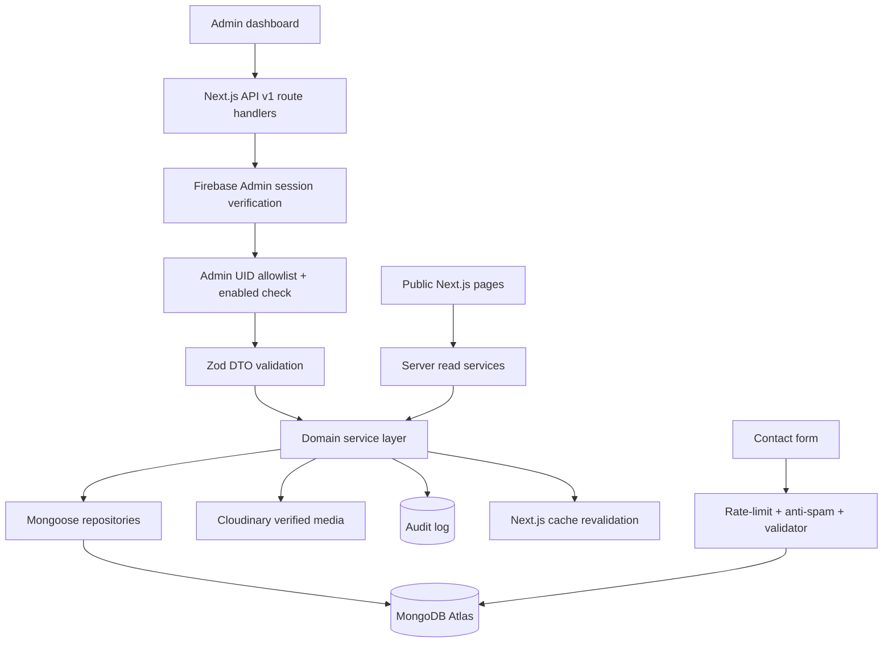
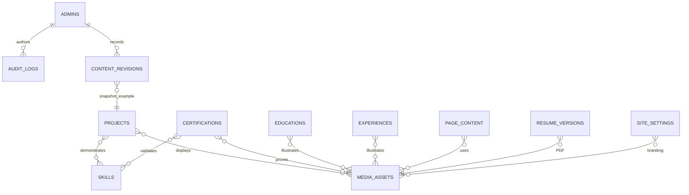
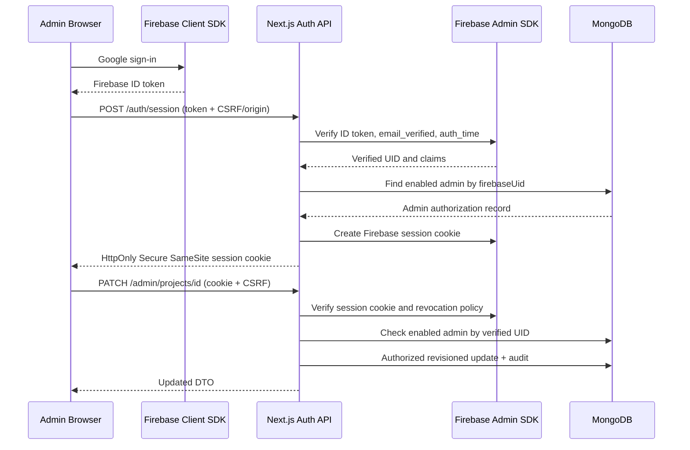
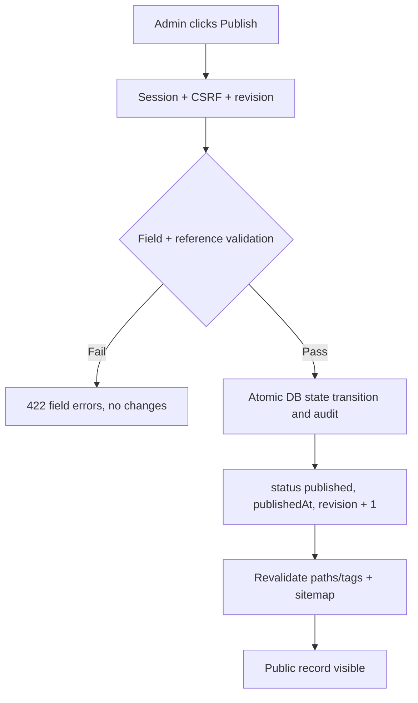
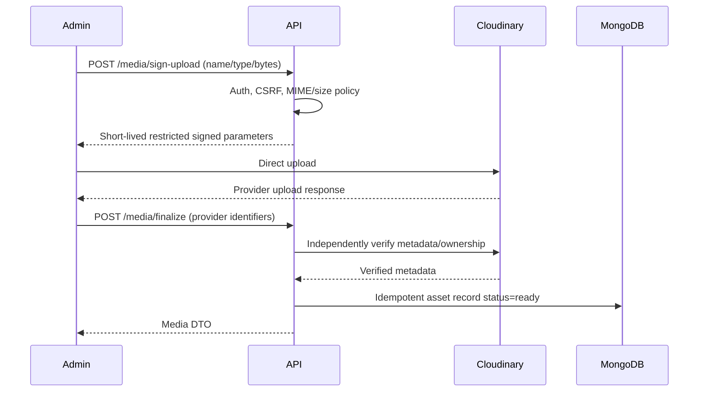

# Dynamic 3D Portfolio & Personal CMS — Backend Schema Specification

**Document ID:** PORTFOLIO-BES-001  
**Version:** 1.0  
**Date:** 2026-10-13  
**Status:** Proposed implementation baseline; verify existing portfolio content in Phase 0  
**Companion documents:** PRD v1.0, TRD v1.0, Application Flow v1.0, UI/UX Design Brief v1.0  
**Stack:** Next.js App Router, TypeScript, MongoDB Atlas, Mongoose, Zod, Firebase Authentication/Admin SDK, Cloudinary  
**Scope:** Single-owner private CMS, public published portfolio, phased MVP → V1.5 → V2

> **Engineering rule:** The TRD is the governing contract for `/api/v1`, authentication and publishing. This document refines collection details and proposes missing contracts. Any contradiction must be resolved via an architecture decision record (ADR) before coding. Existing portfolio content has not been independently audited; examples are illustrative rather than claims about real data.

## 1. Scope and design principles

### 1.1 MVP (P0)

- Private administrator identity and server-side session enforcement.
- Dynamic management of projects, certificates, skills, education, experience, profile, media, navigation, page content, resume and site settings.
- Public contact submissions; private admin inbox.
- Explicit `draft` / `published` / `archived` publication states for publishable content.
- Revision-based optimistic concurrency, audit logging, safe uploads, bounded queries, backup/export and content migration.
- SEO metadata; cache revalidation; published-only public data.

### 1.2 V1.5 (P1)

- Blog posts, research/publications, testimonials, timeline events, richer content revision browsing/restore, redirects and enhanced audience modes.
- GitHub synchronization metadata, optional analytics aggregates, dynamic resume variants.

### 1.3 V2 (P2)

- AI assistant knowledge index, advanced recommendations, localization records, optional 3D-scene content controls.
- Do not create speculative databases or public accounts before feature approval.

### 1.4 Modeling rules

1. **MongoDB is the content source of truth.** Firebase manages sign-in identities, never authorizes MongoDB writes by itself.
2. Store cross-document references as BSON `ObjectId`, verify references in services, and use explicit public DTOs.
3. Store dates as BSON `Date` in UTC, serialize as ISO 8601 strings; do not put formatted display dates in MongoDB.
4. Store files in Cloudinary or approved storage; MongoDB holds verified asset metadata, not large binary files.
5. Reject unknown API fields using strict Zod object validation and allowlist mutation fields.
6. No raw client-supplied MongoDB filters/operators, HTML scripts, update operators or unvalidated URLs.
7. Public pages never return admin identity, draft records, private storage metadata, contact submissions or audit history.
8. Prefer archiving over destructive deletion; provide consistent reference-aware deletion policies.
9. Publish transitions and slugs are validated by server services; never allow arbitrary `status` updates through generic PATCH.
10. Keep changes backward compatible during deployment; migrations are versioned and idempotent.

## 2. High-level backend architecture



**Suggested boundaries**: `src/lib/db`, `src/lib/auth`, `src/lib/security`, `src/features/<domain>/{models,schemas,services,repositories,mappers}`, `src/app/api/v1`, `src/lib/cache`, `src/lib/media`, `src/lib/audit`, `src/lib/errors`, `src/lib/pagination`, `src/scripts/migrations`.

Do not fetch your own API from server components when a trusted read service can be called directly. All browser-to-server writes still pass through authentication, validation and authorization.

## 3. Relationship overview



**Note:** MongoDB does **not** enforce these relationships. This diagram is conceptual; `contentRevisions` is polymorphic and can reference other entity types, not just projects. Many-to-many relationships use bounded ObjectId arrays in the primary record unless the verified content volume demands a separate join collection.

## 4. Shared types and rules

### 4.1 Canonical base fields

```ts
export type PublicationStatus = 'draft' | 'published' | 'archived';
export type PublicAudience = 'general' | 'recruiter' | 'client' | 'developer' | 'researcher';

type Managed = {
  _id: Types.ObjectId;
  createdAt: Date;
  updatedAt: Date;
  revision: number;                 // starts at 1; increment for each change
  createdByUid: string;
  updatedByUid: string;
};

type Publishable = Managed & {
  slug: string;                     // lower-case unique route slug
  status: PublicationStatus;
  publishedAt: Date | null;
  sortOrder: number;
  seo: {
    title?: string;
    description?: string;
    ogAssetId?: Types.ObjectId | null;
    canonicalUrl?: string | null;
    noIndex?: boolean;
  };
};
```

- `createdAt` / `updatedAt` are managed by Mongoose timestamps. `revision` is an explicit counter distinct from Mongoose `__v`; strip `__v` from DTOs.
- Required admin-authored records use `createdByUid` and `updatedByUid`. Import tooling uses an explicitly recorded migration actor (`migration:<batch-id>`), not an invented Firebase user.
- `publishedAt` is set when first published and may be retained on unpublish for audit; if the UI needs last publish time, add `lastPublishedAt` in an ADR. Do not use `publishedAt != null` to determine public visibility: **only `status === 'published'`**.
- Slugs: `^[a-z0-9]+(?:-[a-z0-9]+)*$`, 2–100 chars, case-insensitive normalized to lowercase; retain redirect history when changed.
- String length and array limits must be enforced in both Zod and Mongoose, with publish-time business validation for cross-field requirements.

### 4.2 URLs, emails, rich text and IDs

| Primitive | Server rule |
|---|---|
| ObjectId | 24 hexadecimal characters in request DTO; convert via `Types.ObjectId` only after parse |
| External URL | `https:` only for public links; explicit `mailto:` exception for contact destinations |
| Email | normalized, max 254 chars; never output private contact addresses unless configured public |
| Slug | lowercase ASCII slug; reserved paths rejected; uniqueness enforced at DB level |
| Plain text | trim, bound length, escape at rendering; rich text sanitized using an allowlist |
| Rich content | use Tiptap JSON or controlled Markdown; specify **one canonical format** in ADR |
| Image alt | required on meaningful public images; decorative assets explicitly marked decorative |
| Date ranges | reject `endDate < startDate` and `expiresAt < issuedAt` |
| HTML | raw user-provided HTML and script embeds forbidden by default |

### 4.3 Audit and revision invariants

- Every successful admin mutation records actor, action, entity, record ID, timestamp, request ID, result, and sanitized changed-fields summary.
- A stale `revision` returns HTTP `409 CONFLICT`; records must not be silently overwritten.
- Audit logs are append-only at the application layer; do not write secrets, full message bodies, bearer tokens or credentials into them.
- `contentRevisions.snapshot` stores an allowlisted content snapshot before mutation. Cap snapshot sizes and reject embedded file blobs.
- For multi-record changes (publish + revision + audit), use a transaction where supported; if transactions are unavailable, use idempotent operations and an outbox/recovery design. Never claim atomicity across MongoDB and Cloudinary.

## 5. MongoDB collection catalog

| Collection | Release | Purpose | Admin/public |
|---|---|---|---|
| `admins` | P0 | Firebase UID allowlist, enabled status, last sign-in | private |
| `projects` | P0 | Portfolio project case studies | published public |
| `certifications` | P0 | Credential data and proof | published public |
| `skills` | P0 | Skills and project evidence | visible public |
| `experiences` | P0 | Jobs, volunteering and leadership | visible public |
| `educations` | P0 | Academic information | visible public |
| `mediaAssets` | P0 | Uploaded object metadata | selected assets public |
| `messages` | P0 | Contact inbox | private |
| `siteSettings` | P0 | Public identity and site configuration | projected public |
| `resumeVersions` | P0 | Resume PDFs and versions | active published public |
| `navigation` | P0 | Navigation and footer links | enabled public |
| `pageContent` | P0 | CMS-managed home and static content | published public |
| `auditLogs` | P0 | Security/content actions | private |
| `contentRevisions` | P0/P1 | Snapshots; full history UI in P1 | private |
| `redirects` | P1 | Old slugs and paths | public redirect behavior |
| `posts` | P1 | Technical blog | published public |
| `research` | P1 | Publications and research work | published public |
| `testimonials` | P1 | Approved endorsements | approved public |
| `timelineEvents` | P1 | Chronological milestones | published public |

The TRD includes `categories` as **optional**; for MVP, start with bounded category strings/enums on projects, or adopt a `categories` collection only after ADR approval. Do not keep `categoryIds[]` without implementing the referenced collection and migration strategy. See compatibility note §17.

## 6. Detailed collection schemas

### 6.1 `admins` (P0)

| Field | Type | Rule |
|---|---|---|
| `firebaseUid` | String | required, immutable, unique |
| `email` | String | verified owner email, normalized; private |
| `enabled` | Boolean | default false until seeded securely |
| `displayName` | String | optional 1–100 |
| `lastLoginAt` | Date | nullable |
| `createdAt`, `updatedAt` | Date | timestamps |

**Indexes**: `firebaseUid` unique; optional `email` unique if business policy requires it. **Authorization:** require valid Firebase Admin session **and** `admins.firebaseUid === decoded.uid && enabled === true`; a matching email by itself is insufficient. Provision via a one-time secured seed script, not a public create-admin API. If restricting exactly one owner, assert enabled-admin count during provisioning.

### 6.2 `projects` (P0)

| Field | Type | Validation / meaning |
|---|---|---|
| `title` | String | required 2–120 |
| `slug` | String | required, globally unique |
| `tagline` | String | optional ≤180 |
| `summary` | String | required 10–500 |
| `overview`, `problem`, `solution` | String / approved rich content | each bounded; long-form case study |
| `features[]`, `outcomes[]` | String[] | ≤50 / ≤30, item ≤300 |
| `role` | String | optional ≤120 |
| `techSkillIds[]` | ObjectId[] → skills | ≤60; deduplicate |
| `categoryIds[]` | ObjectId[] → categories | optional **only if** categories collection chosen |
| `categories[]` | String[] | alternative to `categoryIds`, never both live without ADR |
| `coverAssetId` | ObjectId → mediaAssets | optional during draft |
| `galleryAssetIds[]` | ObjectId[] → mediaAssets | ≤30 |
| `repositoryUrl`, `demoUrl` | HTTPS string | optional |
| `documentationUrl`, `videoUrl` | HTTPS string | optional extension |
| `featured` | Boolean | default false |
| `startDate`, `endDate` | Date | optional; chronological validation |
| `audiences[]` | PublicAudience[] | optional P1; affects discovery, not authorization |
| `seo`, `status`, `publishedAt`, `sortOrder`, `revision`, actor/timestamps | shared | enforced |

**Indexes**: `{slug:1}` unique; `{status:1,featured:-1,sortOrder:1,_id:1}`; `{status:1,updatedAt:-1,_id:1}`; optionally `{status:1,techSkillIds:1}` if needed by observed queries. Stable paging sorts MUST end with `_id` tie-breaker. A published project must have valid metadata and verified media or an approved fallback.

### 6.3 `certifications` (P0)

Fields: `title` (required, 2–160), `slug` (unique), `issuer` (required, ≤160), `issuedAt` (required Date), `expiresAt` (nullable Date), `credentialId` (optional, ≤200), `verificationUrl` (HTTPS, nullable), `assetId` (ObjectId → mediaAssets, nullable), `skillIds[]` (ObjectId → skills, ≤40), `description` (≤5000), `category` (enum/string as approved), shared publishable fields. Validate expiry is not before issue date. Publishing requires an issuer/title/date and either verified asset or verification link, unless product owner explicitly approves an alternative. Do **not** publish private ID numbers accidentally.

**Indexes**: `{slug:1}` unique; `{status:1,issuedAt:-1,_id:1}`; optional `{status:1,issuer:1}`.

### 6.4 `skills` (P0)

Fields: `name` (2–80), `slug` (unique), `category` (e.g. `frontend|backend|database|devops|security|tools|other`, centrally configurable), `description` (≤1500), `iconAssetId` (nullable), `evidenceProjectIds[]` (≤60), `sortOrder` (integer), `visible` (boolean), actor/timestamps and `revision`. Avoid self-scored proficiency percentages unless an evidence rubric exists. For P1 consider `audiences[]`.

**Indexes**: `{slug:1}` unique; `{visible:1,category:1,sortOrder:1,_id:1}`. A `visible` skill is public independent of publish lifecycle; this is a deliberate difference from projects/certifications.

### 6.5 `experiences` (P0)

Fields: `organization` (required ≤160), `title` (required ≤160), `employmentType` (`full_time|part_time|contract|internship|volunteer|leadership|other`), `location` (optional), `locationType` (`remote|onsite|hybrid|unspecified`), `startDate` (required), `endDate` (nullable), `isCurrent` (boolean), `highlights[]` (≤30 entries), `links[]` ({`label`,`url`} ≤10), `logoAssetId` (nullable), `visible` (boolean), `sortOrder`, `revision`, actor/timestamps. `isCurrent` implies `endDate === null`.

**Indexes**: `{visible:1,startDate:-1,_id:1}`.

### 6.6 `educations` (P0)

Fields: `institution` (required ≤180), `degree` (required ≤160), `field` (required ≤160), `startDate` (required), `endDate` (nullable), `isCurrent` (boolean), `summary` (≤5000), `achievements[]` (≤30), `institutionLogoAssetId` (nullable), `visible`, `sortOrder`, `revision`, actor/timestamps. Do not assume graduation dates from ongoing enrollment.

**Indexes**: `{visible:1,startDate:-1,_id:1}`.

### 6.7 `mediaAssets` (P0)

| Field | Type | Rule |
|---|---|---|
| `storageProvider` | `cloudinary` | enum; extensible later |
| `providerAssetId` | String | verified provider asset ID, immutable |
| `publicId` | String | provider public ID; private to admin DTO if needed |
| `secureUrl` | HTTPS String | provider-delivered asset URL; validate host |
| `resourceType` | `image|video|raw|model` | bounded approved type |
| `mimeType` | String | allowlisted, verified from provider |
| `bytes` | Number | positive, below policy cap |
| `width`, `height`, `durationSeconds` | Number | optional verified dimensions |
| `altText`, `caption` | String | bounded; presentation metadata |
| `decorative` | Boolean | default false |
| `ownerUid` | String | verified admin UID |
| `visibility` | `public|private` | do not expose private URLs |
| `status` | `pending|ready|quarantined|deleted` | finalized assets only can be published |
| `usageRefs[]` | typed entity/id pair | optional derived usage references; not sole truth |
| `createdAt`, `updatedAt` | Date | timestamps |

**Indexes**: unique `{storageProvider:1,providerAssetId:1}`; `{status:1,createdAt:-1}`; `{ownerUid:1,createdAt:-1}`. Finalize uploads only after independently reading provider metadata and confirming ownership/signature, type, byte size, permitted folder and request binding. **Warning:** Cloudinary delivery URLs for PDFs/3D files require configured resource types/access controls; model all uploaded types against actual provider support, don't assume any file is publicly usable.

### 6.8 `messages` (P0)

Fields: `name` (2–120), `email` (valid ≤254), `subject` (2–200), `message` (10–10000), `status` (`unread|read|replied|archived|spam`), `receivedAt` (Date), `consentVersion` (nullable), `sourcePage` (sanitized path), `spamScore` (optional bounded numeric), `abuseHash` (nullable time-bounded pseudonymous value; avoid raw IP where possible), `createdAt`, `updatedAt`. Public create DTO must **not** accept `status`, `spamScore`, or internal fields.

**Indexes**: `{status:1,receivedAt:-1,_id:1}`. Set retention policy and automate deletion only when approved. Always use CAPTCHA/honeypot/rate limiting as appropriate; suppress contact form email enumeration.

### 6.9 `siteSettings` (P0)

Singleton `{key:'primary'}` (unique) with nested `profile` (`displayName`, `headline`, `shortBio`, `longBio`, `locationDisplay`, `availabilityStatus`, `publicEmail` only when explicitly enabled), `socialLinks[]` typed URLs, `branding` (`logoLightAssetId`, `logoDarkAssetId`, `faviconAssetId`), `theme` (`defaultMode`, `accentToken`), `features` (approved booleans), `seoDefaults`, `contact` (public contact settings), `revision`, actor/timestamps. Secrets, API tokens and Firebase service credentials **must not be stored** here. Public DTO is an explicit subset.

**Index**: `{key:1}` unique; enforce `key === 'primary'` in application code.

### 6.10 `resumeVersions` (P0)

Fields: `label` (required ≤120), `audience` (`general|recruiter|client|developer|researcher`), `assetId` (required ObjectId → verified PDF asset), `isDefault` (boolean), `status` (`draft|published|archived`), `publishedAt` (nullable), `sortOrder`, `revision`, actor/timestamps. Optionally `resumeContent` structured content in P1. Never allow an unpublished or private resume as a public default.

**Indexes**: `{audience:1,status:1,isDefault:1}` plus conditional unique index `{audience:1}` with partial filter `{status:'published',isDefault:true}` to enforce at most one published default per audience. Service ensures appropriate fallback if none exists.

### 6.11 `navigation` (P0)

Fields: `key` (`header|footer|mobile` or approved names), `items[]` {`id` stable key, `label`, `href`, `external`, `enabled`, `sortOrder`, optional `audiences[]`}, `revision`, actor/timestamps. Reject dangerous protocols, invalid internal routes, unbounded nesting and cyclic navigation. Internal links begin with `/`; external links require HTTPS.

**Index**: `{key:1}` unique.

### 6.12 `pageContent` (P0)

Fields: `pageKey` (`home|about|contact|resume|...` unique), `slug` (needed when page has public URL; may be canonical static slug), `sections[]` typed discriminated blocks (`hero|richText|projectShowcase|skillsGrid|cta|media|timelinePreview` etc.), `status`, `publishedAt`, `seo`, `sortOrder`, `revision`, actor/timestamps. Each section has `{id,type,enabled,data}`; `data` is validated against its type-specific Zod schema. Avoid arbitrary injected React/JS/HTML in content blocks.

**Index**: `{pageKey:1}` unique; optional `{status:1,pageKey:1}`. Treat `pageKey` uniqueness as authoritative, not `slug`, for singleton routes.

### 6.13 `auditLogs` (P0)

Fields: `actorUid`, `action`, `entityType`, `entityId` (nullable), `timestamp`, `result` (`success|failure`), `requestId`, `ipHash` (optional), `userAgentSummary` (optional), `changeSummary` (redacted allowed field names), `metadata` (small allowlisted object). Append-only, admin-readable, prohibit client-supplied actor/timestamp. Size cap and retention schedule required.

**Index**: `{timestamp:-1,actorUid:1}`; `{entityType:1,entityId:1,timestamp:-1}` if entity history display is built.

### 6.14 `contentRevisions` (P0 foundation, P1 UI)

Fields: `entityType` (approved collection enum), `entityId` (ObjectId), `version` (positive int), `snapshot` (validated JSON content; no sensitive user-submitted contact payloads), `authorUid`, `createdAt`, `changeNote` (optional). Unique `{entityType:1,entityId:1,version:1}`. Restores create a **new revision** rather than rewriting history. For versioned published snapshots, restore to draft and require explicit republication.

### 6.15 `redirects` (P1)

Fields: `fromPath` (unique normalized internal path), `toPath` (validated same-site path or explicitly approved HTTPS), `httpStatus` (308 only initially), `enabled`, `createdAt`, `updatedAt`. Prevent redirect loops, open redirects and self-redirects. Revalidate affected routes. **Index** `{fromPath:1}` unique.

### 6.16 V1.5 content collections

- `posts`: publishable base + `title`, `excerpt`, `body` (canonical editor format), `coverAssetId`, `tags[]`, `category`, `readingTimeMinutes` (derived), `authorDisplayName`, `featured`, `seo`. Index `{slug:1}` unique and `{status:1,publishedAt:-1,_id:1}`.
- `research`: publishable base + `title`, `abstract`, `researchType` (`paper|project|preprint|presentation|other`), `authors[]`, `venue`, `doi`, `publicationDate`, `documentAssetId`, `externalUrl`, `topics[]`, `collaborators[]` (typed display entries). DOI normalized and unique when appropriate, never fabricate publication records. Index `{slug:1}` unique and `{status:1,publicationDate:-1,_id:1}`.
- `testimonials`: `name`, `role`, `organization`, `quote`, `sourceUrl`, `avatarAssetId`, `consentRecordedAt`, `approvalStatus` (`pending|approved|rejected`), `visible`, `sortOrder`, `revision`, actor/timestamps. Public queries require approved + visible. No unauthenticated public testimonials create endpoint in MVP.
- `timelineEvents`: publishable base + `title`, `eventDate`, `endDate?`, `category`, `description`, `relatedEntityType`, `relatedEntityId`, `mediaAssetId`, `featured`, `seo`; index `{status:1,eventDate:-1,_id:1}`.

## 7. Recommended Mongoose implementation patterns

### 7.1 Connection helper (`src/lib/db/connect.ts`)

```ts
import mongoose from 'mongoose';

const uri = process.env.MONGODB_URI;
if (!uri) throw new Error('MONGODB_URI missing');

const cache = globalThis as typeof globalThis & {
  __mongoose?: { conn: typeof mongoose | null; promise: Promise<typeof mongoose> | null };
};
const state = cache.__mongoose ??= { conn: null, promise: null };

export async function connectDB() {
  if (state.conn) return state.conn;
  if (!state.promise) {
    state.promise = mongoose.connect(uri, {
      serverSelectionTimeoutMS: 10000,
      maxPoolSize: 10,
    });
  }
  try {
    state.conn = await state.promise;
    return state.conn;
  } catch (error) {
    state.promise = null;
    throw error;
  }
}
```

**Implementation caveat:** This is a reference pattern. Tune pooling/concurrency to deployment capacity; do not create a new database connection for each request. This code belongs in the Node.js runtime, not Next.js Edge runtime.

### 7.2 Example executable-style Project model (`src/features/projects/models/project.model.ts`)

```ts
import { Schema, model, models, type InferSchemaType } from 'mongoose';

const SeoSchema = new Schema({
  title: { type: String, trim: true, maxlength: 70 },
  description: { type: String, trim: true, maxlength: 170 },
  ogAssetId: { type: Schema.Types.ObjectId, ref: 'MediaAsset', default: null },
  canonicalUrl: { type: String, default: null },
  noIndex: { type: Boolean, default: false },
}, { _id: false, strict: 'throw' });

const ProjectSchema = new Schema({
  title: { type: String, required: true, trim: true, minlength: 2, maxlength: 120 },
  slug: { type: String, required: true, lowercase: true, trim: true,
    minlength: 2, maxlength: 100, match: /^[a-z0-9]+(?:-[a-z0-9]+)*$/ },
  tagline: { type: String, trim: true, maxlength: 180 },
  summary: { type: String, required: true, trim: true, minlength: 10, maxlength: 500 },
  overview: { type: String, maxlength: 50000 },
  problem: { type: String, maxlength: 20000 },
  solution: { type: String, maxlength: 20000 },
  features: { type: [{ type: String, maxlength: 300 }], default: [] },
  outcomes: { type: [{ type: String, maxlength: 300 }], default: [] },
  role: { type: String, maxlength: 120 },
  techSkillIds: { type: [{ type: Schema.Types.ObjectId, ref: 'Skill' }], default: [] },
  coverAssetId: { type: Schema.Types.ObjectId, ref: 'MediaAsset', default: null },
  galleryAssetIds: { type: [{ type: Schema.Types.ObjectId, ref: 'MediaAsset' }], default: [] },
  repositoryUrl: { type: String, default: null },
  demoUrl: { type: String, default: null },
  featured: { type: Boolean, default: false },
  startDate: { type: Date, default: null },
  endDate: { type: Date, default: null },
  status: { type: String, enum: ['draft', 'published', 'archived'], default: 'draft', required: true },
  publishedAt: { type: Date, default: null },
  sortOrder: { type: Number, default: 0 },
  seo: { type: SeoSchema, default: () => ({}) },
  revision: { type: Number, required: true, default: 1, min: 1 },
  createdByUid: { type: String, required: true },
  updatedByUid: { type: String, required: true },
}, { timestamps: true, strict: 'throw', versionKey: false, collection: 'projects' });

ProjectSchema.index({ slug: 1 }, { unique: true });
ProjectSchema.index({ status: 1, featured: -1, sortOrder: 1, _id: 1 });
ProjectSchema.index({ status: 1, updatedAt: -1, _id: 1 });

export type ProjectRecord = InferSchemaType<typeof ProjectSchema>;
export const ProjectModel = models.Project || model('Project', ProjectSchema);
```

**Not a complete production implementation:** Add project-specific array-length checks, URL schema validation, reference verification, content sanitization and service-level publish checks. `unique` is a **database index**, not a validation rule. In production, create/migrate indexes using an approved script rather than relying on uncontrolled automatic index builds.

### 7.3 Zod create/update separation

```ts
import { z } from 'zod';

const ObjectIdText = z.string().regex(/^[a-f\d]{24}$/i);
const HttpsUrl = z.string().url().refine(v => new URL(v).protocol === 'https:');

export const ProjectCreate = z.object({
  title: z.string().trim().min(2).max(120),
  slug: z.string().regex(/^[a-z0-9]+(?:-[a-z0-9]+)*$/).min(2).max(100),
  summary: z.string().trim().min(10).max(500),
  tagline: z.string().trim().max(180).optional(),
  coverAssetId: ObjectIdText.nullish(),
  techSkillIds: z.array(ObjectIdText).max(60).default([]),
  galleryAssetIds: z.array(ObjectIdText).max(30).default([]),
  repositoryUrl: HttpsUrl.nullish(),
  demoUrl: HttpsUrl.nullish(),
  featured: z.boolean().default(false),
}).strict();

export const ProjectPatch = ProjectCreate.partial().extend({
  revision: z.number().int().positive(),
}).strict();
```

Expand the DTO with other editable fields before use. **Do not** put `status`, `createdByUid`, `updatedByUid`, `publishedAt` or `_id` in generic create/patch DTOs. `ProjectPatch` includes `revision` as a required concurrency precondition; never use `.partial()` after extending it or it will become optional.

## 8. Backend API contract and data shape

Base path: `/api/v1`; transport: JSON, versioned REST; auth cookie for admin routes. All mutation responses have `Cache-Control: no-store`.

### 8.1 Standard envelopes

**Success**

```json
{ "success": true, "data": { "id": "64c000000000000000000001" }, "meta": { "nextCursor": null } }
```

**Error**

```json
{ "success": false, "error": { "code": "VALIDATION_ERROR", "message": "Invalid payload", "details": [{ "path": "title", "message": "Required" }] }, "requestId": "req-example" }
```

Use stable codes: `UNAUTHENTICATED` (401), `FORBIDDEN` (403), `NOT_FOUND` (404), `CONFLICT` (409), `VALIDATION_ERROR` (422), `RATE_LIMITED` (429), `INTERNAL_ERROR` (500), and appropriate 413/415 for file constraints. Do not leak raw stack traces or MongoDB messages.

### 8.2 Public endpoints

| Method | Route | DTO/content constraints |
|---|---|---|
| GET | `/api/v1/public/profile` | projected public identity/socials |
| GET | `/api/v1/public/projects` | published-only; `q`, `category`, `skill`, `cursor`, `limit` |
| GET | `/api/v1/public/projects/:slug` | published-only; 404 for draft/archived |
| GET | `/api/v1/public/certifications` | published-only; bounded paging |
| GET | `/api/v1/public/certifications/:slug` | published-only; 404 otherwise |
| GET | `/api/v1/public/skills` | `visible: true` only |
| GET | `/api/v1/public/experience` | `visible: true` only |
| GET | `/api/v1/public/education` | `visible: true` only |
| GET | `/api/v1/public/navigation` | enabled links only |
| POST | `/api/v1/contact` | rate-limited validated submission |
| GET | `/api/v1/public/posts`, `/research` | P1, published-only |

The public portfolio pages typically call the server read services directly; APIs remain useful for client-driven filters and integrations.

### 8.3 Authentication endpoints

| Method | Route | Behavior |
|---|---|---|
| POST | `/api/v1/auth/session` | verify Firebase ID token, authorized UID, recent sign-in; issue HTTP-only cookie |
| GET | `/api/v1/auth/me` | return minimal authorized admin profile; `no-store` |
| POST | `/api/v1/auth/logout` | verify origin/CSRF, clear session cookie; optional revocation policy |

### 8.4 Admin endpoints

| Method | Route | Behavior |
|---|---|---|
| GET, POST | `/api/v1/admin/projects` | list all statuses / create draft |
| GET, PATCH, DELETE | `/api/v1/admin/projects/:id` | detail / revisioned edit / archive |
| POST | `/api/v1/admin/projects/:id/publish` | publish-time invariants, revision, revalidation |
| POST | `/api/v1/admin/projects/:id/unpublish` | return to draft, remove public visibility |
| POST | `/api/v1/admin/projects/:id/duplicate` | new draft with unique slug |
| GET, POST | `/api/v1/admin/certifications` | list / draft create |
| GET, PATCH, DELETE | `/api/v1/admin/certifications/:id` | detail / edit / archive |
| POST | `/api/v1/admin/certifications/:id/publish` | **proposed TRD amendment:** explicit credential publishing |
| POST | `/api/v1/admin/certifications/:id/unpublish` | **proposed amendment:** explicit credential unpublishing |
| GET, POST, PATCH, DELETE | `/api/v1/admin/skills`, `/skills/:id` | CRUD |
| GET, POST, PATCH, DELETE | `/api/v1/admin/experience`, `/experience/:id` | CRUD |
| GET, POST, PATCH, DELETE | `/api/v1/admin/education`, `/education/:id` | CRUD |
| GET, PATCH | `/api/v1/admin/profile`, `/settings` | public profile, private site config |
| POST | `/api/v1/admin/media/sign-upload` | approved constrained signed upload |
| POST | `/api/v1/admin/media/finalize` | verify remote asset, create ready record |
| GET, PATCH, DELETE | `/api/v1/admin/media`, `/media/:id` | list/update/reference-aware archive |
| GET, PATCH, DELETE | `/api/v1/admin/messages`, `/messages/:id` | inbox and status |
| GET, PATCH | `/api/v1/admin/resume` | published/default version rules |
| GET | `/api/v1/admin/dashboard` | real counts and activity |
| GET | `/api/v1/admin/audit-logs` | private paginated read |
| GET | `/api/v1/admin/export` | portable authenticated data export |

P1 adds analogous endpoints for posts, research, page content, revisions, navigation, redirects, testimonials and timeline. Document all routes in `docs/openapi.yaml`, keeping Zod/OpenAPI in sync.

### 8.5 Pagination and DTO projection

- Default list size 12, max 50, with whitelisted sort keys and stable `_id` tie-breaker.
- Cursor encodes last sort value + `_id`; sign or validate to avoid untrusted query operators.
- DTO mapper serializes ObjectIds and dates and omits private fields; public responses never expose `createdByUid`, `updatedByUid`, raw cloud storage IDs or `revision` unless explicitly necessary.
- Return 404 (not 403) for unpublished public slug lookups to avoid revealing draft existence.

## 9. Authentication, authorization and sessions



- **Never** rely on route hiding or client-only route guards.
- Cookies: `HttpOnly`, `Secure` in production, `SameSite=Lax` or stricter, narrowly scoped `Path`, explicit expiration; use a `__Host-` prefix where deployment permits it.
- State-changing cookie-authenticated endpoints enforce CSRF token and origin checks. Reject invalid/missing Origin according to documented browser and test-client policy.
- Firebase session creation should require **recent authentication** according to a defined `auth_time` threshold. Validate Firebase token issuer/audience via the Admin SDK.
- Admin operations should be `no-store`; render protected pages server-side or guard all server handlers.
- For sign-out clear cookie; for lost-device compromise allow Firebase refresh-token revocation/session invalidation with appropriate policy. Be mindful of latency/cost of per-request revocation checks.
- Do not create public sign-up or additional admin accounts in MVP.

## 10. Mutation, preview, and publication workflows

### 10.1 Draft creation

1. Verify admin session and CSRF.
2. Zod-parse create DTO; force `status='draft'`, `revision=1`, and server-derived actor UID.
3. Insert into MongoDB; catch unique slug collisions as conflict.
4. Append audit entry; return `201` with private DTO.

### 10.2 Optimistic PATCH

```ts
// conceptual service code; validate patch allowlist and existing record first
const updated = await ProjectModel.findOneAndUpdate(
  { _id: projectId, revision: expectedRevision },
  { $set: sanitizedFields, $inc: { revision: 1 } },
  { new: true, runValidators: true }
);
if (!updated) {
  // Read existing ID separately: 404 if absent, 409 if stale revision.
}
```

Save prior snapshot within transaction where supported. **Never** accept client `$inc`, `$set`, or raw Mongo query JSON. Ensure server sets `updatedByUid` and timestamps.

### 10.3 Publish flow



**Publish validation** checks slug/title/summary, verified media ownership/status, existing skill references, safe public URLs, SEO, special content-type rules, and expected `revision`. A failed DB mutation must not leave a public record partially published. Revalidation may be retried idempotently if downstream cache operations fail; log and alert on repeated failure.

### 10.4 Preview

Admin preview endpoints/pages require an authorized session and `no-store`, render draft data through private services, and must not be indexable. Do not create publicly guessable draft preview URLs or leak preview access into public sitemap/OG metadata. If temporary preview links are introduced later, sign them with short expirations and narrowly scoped capabilities.

### 10.5 Unpublish/archive/delete

- Unpublish: `published → draft`, public queries immediately exclude record; revalidate routes, listings, sitemap, related caches.
- Archive: hide from public and default admin lists; maintain record for restore.
- Delete media: prevent deletion while referenced by published content; validate provider ownership and reference counts, then queue safe deletion.
- Changing slug: create safe redirect (P1) or avoid destructive slug changes until redirect support exists.

## 11. Media upload data flow



Upload allowlist and limits are environment-configurable and must be documented. Starting policy recommendation: images (JPEG/PNG/WebP/AVIF), PDFs, selected MP4, approved GLB/GLTF assets; validate actual file signatures/metadata, not filename alone. Allow 3D types only after explicit processing, CSP and public-delivery review. Strip sensitive image EXIF as appropriate. Quarantine and clean up abandoned uploads. For accessibility, require informative `altText` unless `decorative=true`.

## 12. Public rendering, SEO and audience modes

- Server-render public name, headlines, about, projects and certificate metadata. 3D scenes must be optional client-side enhancements and do not alter MongoDB permissions.
- Audience mode (`recruiter`, `client`, `developer`, `researcher`, `general`) changes **presentation priority** and content selection only. It must **not** unlock drafts or private data.
- Public content selector always starts with `{status:'published'}` or `{visible:true}` according to collection.
- Rich page blocks and SEO metadata are sanitized. `noIndex` is honored on pages; admin/preview pages always set `noindex` and require authentication.
- Regenerate sitemap/canonical metadata on publish/unpublish/slug change. Use correct cache invalidation for list, detail and cross-referenced pages.

## 13. Database security, indexes and maintenance

### 13.1 MongoDB Atlas

- Dedicated application database user with least privileges to the portfolio DB; separate migration/maintenance credentials if needed.
- Network restrictions appropriate to deployed environment; TLS required; no credentials in client bundles or VCS.
- Use separate databases/projects for local/dev, staging and production. Never run test cleanup against production.
- Keep `autoIndex` disabled/controlled in production and apply reviewed index migrations.
- Backups: verify actual plan availability, daily export/snapshot strategy, retention and restore drill.

### 13.2 Index migration checklist

1. Check existing duplicates and invalid slugs.
2. Normalize data before unique index creation.
3. Build one index migration at a time where operationally necessary.
4. Use `explain()` against critical public queries and ensure stable pagination.
5. Store migration version/batch metadata and execution results.
6. Document rollback limitations for index and data transformations.

### 13.3 Minimum index map

```js
// Applied by reviewed migration scripts, not blindly on every deploy
projects: [{slug:1}, {status:1,featured:-1,sortOrder:1,_id:1}]
certifications: [{slug:1}, {status:1,issuedAt:-1,_id:1}]
skills: [{slug:1}, {visible:1,category:1,sortOrder:1,_id:1}]
experiences: [{visible:1,startDate:-1,_id:1}]
educations: [{visible:1,startDate:-1,_id:1}]
mediaAssets: [{storageProvider:1,providerAssetId:1}, {status:1,createdAt:-1}]
messages: [{status:1,receivedAt:-1,_id:1}]
siteSettings: [{key:1}]
navigation: [{key:1}]
pageContent: [{pageKey:1}]
resumeVersions: [{audience:1,status:1,isDefault:1}]
auditLogs: [{timestamp:-1,actorUid:1}]
contentRevisions: [{entityType:1,entityId:1,version:1}]
```

Uniqueness and partial filters are defined in §6. Do not paste the index map directly into a MongoDB console; it is a concise specification, not executable syntax.

## 14. Reliability, observability and operational requirements

- Structured server logs with request IDs and error codes; remove tokens, cookies, credential IDs, message content and private addresses.
- Health checks distinguish app liveness from actual DB connectivity; don't expose sensitive environment diagnostics publicly.
- Contact rate limiting and anti-spam; use a shared durable rate-limit store in multi-instance/serverless production if required.
- Retain idempotency identifiers for upload finalize and repeatable migrations.
- Surface cache revalidation, provider failures and DB timeouts in monitoring with bounded retries.
- Export content JSON using `schemaVersion`, UTC timestamp, record arrays, logical references and a separate media manifest. Do not include secrets or contact messages in general public content exports.
- Test restore in staging before launch and after major migrations; verify media pointer integrity.
- Maintain runbooks: DB unavailable, broken media, invalid admin session, storage quota exceeded, failed deploy, accidental publication, restore/revert.

## 15. Testing specification and acceptance gates

| ID | Test | Expected result |
|---|---|---|
| BE-001 | Unknown user signs in with valid Firebase token | 403; no session issued |
| BE-002 | Owner UID exists but `enabled=false` | 403 |
| BE-003 | Missing/expired/invalid session on admin mutation | 401 |
| BE-004 | Cookie-authenticated mutation without valid CSRF/Origin | 403 |
| BE-005 | Create valid project | 201; status `draft`, revision 1 |
| BE-006 | Duplicate slug | 409; unchanged existing record |
| BE-007 | Unknown create/PATCH field (`status`, `$set`, `createdByUid`) | 422 |
| BE-008 | PATCH with stale revision | 409; no lost update |
| BE-009 | Publish missing required metadata or invalid referenced asset | 422; stays draft |
| BE-010 | Valid publish | visible to public; cache revalidated |
| BE-011 | Unpublish | public detail returns 404; no sitemap entry |
| BE-012 | Public list filters | never returns draft/archived records |
| BE-013 | Public DTO inspection | no admin IDs, email secrets, tokens or provider private IDs |
| BE-014 | Sign upload oversized/unsupported type | 413/415 or documented 422; no signature |
| BE-015 | Forged media finalize | rejected; no ready asset created |
| BE-016 | Delete referenced published media | blocked unless safe replacement/unlink |
| BE-017 | Contact abuse / rate threshold | 429 or approved abuse response |
| BE-018 | Page section malformed discriminator data | 422 |
| BE-019 | Only one published default resume per audience | enforced under simultaneous updates |
| BE-020 | Invalid redirect / loop | rejected |
| BE-021 | Unique index migration with duplicates | safe failure + remediation report |
| BE-022 | Backup restore drill | records/media references consistent in staging |
| BE-023 | Concurrent publish/PATCH | one winner or safe transactional resolution |
| BE-024 | Admin logout and cookie invalidation | subsequent protected request denied |
| BE-025 | 3D/WebGL unavailable | portfolio data still accessible |
| BE-026 | Migration rerun | idempotent, no duplicate records or assets |
| BE-027 | Invalid external link or rich-text injection | rejected/sanitized; no execution |
| BE-028 | Pagination boundary and cursor tampering | capped, deterministic, invalid cursor rejected |

**MVP gate:** All P0 tests pass in CI/staging, zero critical/high unresolved security findings, production credentials stored server-side, authorized admin-only CMS, public draft exclusion, verified restore strategy, migration reconciliation signed off.

## 16. Schema-first implementation roadmap for AI development

| Phase | Deliverables | Gate |
|---|---|---|
| 0 — Audit | Inspect actual Vite portfolio data and assets; produce source→target mapping and discrepancies | inventory reviewed; no fabricated content |
| 1 — Contracts | shared Zod primitives, enums, content DTOs, error envelope, OpenAPI skeleton | unit tests for invalid payloads |
| 2 — DB & auth | Mongo connection, Admin and audit models, Firebase session verification, CSRF, seed script | BE-001–004 pass |
| 3 — Core CMS | projects, skills, media models/services/API; revisions, publish/unpublish | BE-005–016 pass |
| 4 — Supporting CMS | certifications, education, experience, profile, resume, navigation, page content, contact | key CRUD/DTO tests pass |
| 5 — Public reads | server read services, caching, published filters, sitemap, 3D fallback | BE-010–013, 025 pass |
| 6 — Migration & launch | idempotent migration, redirect policy, backup/restore, smoke/E2E/security audit | BE-021–028 pass and MVP release approved |
| 7 — V1.5 | blog, research, testimonials, timeline, revision UI, audience ranking | P1 test suite completed |
| 8 — V2 | optional AI/indexing and advanced features under separate ADR | privacy/security review and new tests |

### 16.1 One-task-at-a-time AI coding rules

1. Read `docs/PRD.md`, `docs/TRD.md`, `docs/APP_FLOW.md`, `docs/UI_UX_DESIGN_BRIEF.md`, and **this schema document** before changes.
2. Inspect the repository; never invent existing data, assets, API implementations or successful test results.
3. Write or update Zod DTO, Mongoose schema, indexes, mapper, service, API route, OpenAPI and tests **for one domain at a time**.
4. Protect every admin mutation with verified Firebase session + allowlist, CSRF, rate limits as applicable, validation and audit.
5. Distinguish request DTOs from MongoDB persistence models and public response DTOs.
6. Provide tests for successful, invalid, unauthorized, conflict, missing-reference and unpublished states.
7. Run `npm run lint`, `npm run typecheck`, `npm run test`, `npm run build` (or verified equivalent), and report exact results.
8. Stop at the phase gate; present changed files, endpoint/schema diffs, migration changes, issues and next task. Never assert production readiness from code generation alone.

### 16.2 Reusable agent prompt

```text
You are the senior backend architect for the Dynamic 3D Portfolio + Personal CMS.
Treat docs/PRD.md, docs/TRD.md, docs/APP_FLOW.md,
docs/UI_UX_DESIGN_BRIEF.md, docs/BACKEND_SCHEMA.md as binding contracts.

Task: implement ONLY [DOMAIN / PHASE].
1. Audit current repository and summarize existing work.
2. Identify schema/API gaps or contradictions; write an ADR for material deviations.
3. Implement strict Zod DTO, Mongoose model, indexes, typed repository,
   service validation, DTO projections, route handlers and OpenAPI updates.
4. Enforce owner UID authorization, CSRF/session controls, revision checks,
   publication visibility, audit logs and safe media references.
5. Write unit/integration/E2E tests appropriate to this domain.
6. Run lint, typecheck, test and build; report exact passes/failures.
7. Output changed files, migrations, test evidence, risks and next-step gate.
Do not modify unrelated UI, fabricate content, bypass validation or start
subsequent phases without completing this phase's acceptance gate.
```

## 17. Contract reconciliation and outstanding ADRs

This schema intentionally reflects the TRD, but the following decisions must be made **before** related code is shipped:

| ADR | Decision | Recommended outcome |
|---|---|---|
| ADR-001 | `categoryIds[]` in TRD vs optional categories collection | Use `categories[]` normalized slugs in MVP; introduce normalized category collection in P1 if necessary, document migration |
| ADR-002 | rich text persistence | Canonical controlled Markdown or Tiptap JSON; never ambiguous dual formats |
| ADR-003 | certificate publish/unpublish endpoints omitted from initial TRD list | Add explicit `/certifications/:id/publish` + `/unpublish` to OpenAPI and TRD |
| ADR-004 | shared `PublishableRecord` vs `pageContent` keyed by pageKey | Keep `pageKey` unique and use `slug` only for actual routable pages |
| ADR-005 | resume defaults under concurrent publish | Partial unique index plus transactional/default-switch service |
| ADR-006 | date handling for incomplete education history | Allow approximate dates via `datePrecision` or year/month representation only if audit finds source needs |
| ADR-007 | contact message retention and analytics privacy | Publish policy and set bounded retention, do not auto-TTL without owner decision |
| ADR-008 | file hosting and PDF/GLB delivery security | Verify Cloudinary plan, formats, raw file delivery and fallback path |
| ADR-009 | revision/audit atomicity | Use MongoDB transactions where topology supports them; otherwise durable retry/outbox design |
| ADR-010 | deploy platform resources, MongoDB access, cold starts and cache limits | Confirm live hosting limits and cost before deployment |

### Final definition of done

The backend schema is complete **only when** every P0 collection exists with validated models and indexes; API DTOs and OpenAPI match; session/CSRF and allowlist checks gate all writes; publishing cannot leak drafts; media references are verified; revisions prevent lost updates; migrations are idempotent; and the test matrix passes in staging with documented restore evidence.

---

**Document control:** Proposed backend data contract, not evidence of implemented code. Update this document and an ADR for every material schema or API change.
