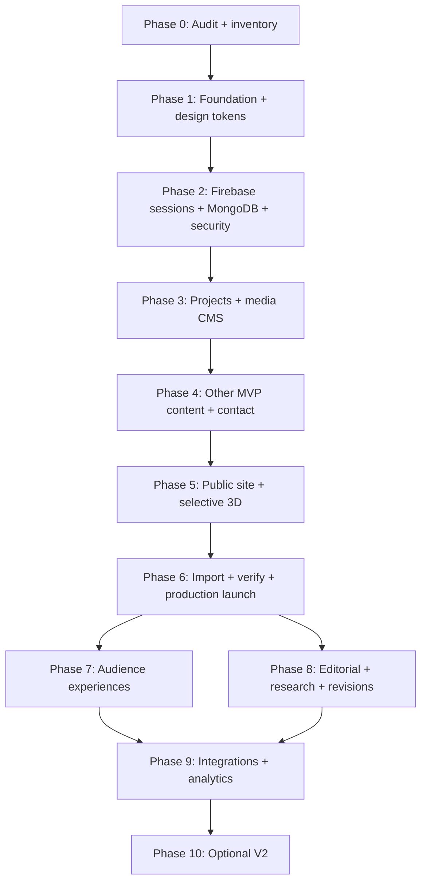

# Dynamic 3D Portfolio & Personal CMS — Implementation Plan

**Document ID:** PORTFOLIO-IMP-001  
**Version:** 1.0  
**Date:** 2026-10-13  
**Status:** Proposed execution baseline; Phase 0 repository audit is mandatory  
**Product owner:** Md. Sabbir Hossen  
**Reference repository:** `https://github.com/MSabbirHossen/MSabbirHossen.github.io`  
**Baseline website:** `https://msabbirhossen.github.io/`  
**Delivery approach:** Next.js full-stack; premium minimal UI with selective 3D; content migration; phased MVP → V1.5 → V2.

> **Usage:** Place this document at `docs/IMPLEMENTATION_PLAN.md`. Execute one ticket at a time. The PRD determines *scope*, the TRD determines *technical contracts*, the Backend Schema document refines *data models*, the App Flow document governs *journeys and states*, and the UI/UX Brief governs *presentation*. Disagreements must be recorded and resolved in an architecture decision record (ADR), not silently guessed. This is a plan, not evidence of an implemented system.

---

## 1. Executive execution strategy

### 1.1 Non-negotiable decisions

- **Runtime:** Next.js App Router + React + strict TypeScript. Server components for content-first public pages; client components only where necessary.
- **API:** Versioned Next.js route handlers at `/api/v1`; thin handlers with services/repositories, Zod validation and standardized response/error envelopes.
- **Persistence:** MongoDB Atlas via Mongoose; Cloudinary for managed media; no MongoDB credentials in the browser.
- **Admin identity:** Firebase Authentication; Firebase Admin SDK for server verification; secure session cookie; single-owner UID allowlist enforced server-side on all write operations.
- **Experience:** HTML content remains usable with JavaScript/WebGL unavailable; React Three Fiber/Drei progressively enhance selected sections.
- **Publishing:** `draft → published → archived` workflow, controlled preview, optimistic revision checks, audit events, and cache revalidation.
- **Quality:** WCAG 2.2 AA target, Core Web Vitals at p75, automated checks and verifiable release gates.
- **Migration:** Inventory, map, import, verify and reconcile existing content; never replace production data from generated examples.

### 1.2 Release boundaries

| Release | Phases | Release promise | Not required yet |
|---|---|---|---|
| MVP | 0–6 | Secure owner CMS; migrated portfolio; projects/certificates/skills/education/experience/resume/contact; responsive public site; selective 3D with fallback; deployed and monitored | AI assistant, audience-specific pages, research/blog editor, advanced 3D world |
| V1.5 | 7–9 | Audience-aware public journeys, research/blog/timeline/revisions, optional GitHub integration and richer analytics | Complex AI, multilingual editorial workflow, fully immersive 3D |
| V2 | 10 | Optional experiments validated by usage and technical feasibility | No unconditional commitments |

### 1.3 Work management model

- Track every work item as `IMP-P{phase}-{number}` with owner, dependencies, priority, scope, acceptance tests and artifact links.
- Statuses: `Backlog → Ready → In progress → In review → Verified → Done`; `Blocked` requires a written reason.
- Limit an AI agent to one bounded ticket per coding pass; do not permit a cross-phase rewrite without an approved ADR.
- Every phase ends with a human-readable walkthrough, changed-file list, tests executed, known issues and rollback instructions.
- Suggested estimates below are **relative effort bands**, not delivery promises: S (≤ half day), M (~1–2 focused days), L (~3–5 days), XL (split before starting). Actual durations depend on source audit and developer capacity.

---

## 2. Project organization and engineering workflow

### 2.1 Target repository layout

```text
/
├── docs/
│   ├── PRD.md
│   ├── TRD.md
│   ├── APP_FLOW.md
│   ├── UI_UX_DESIGN_BRIEF.md
│   ├── BACKEND_SCHEMA.md
│   ├── IMPLEMENTATION_PLAN.md
│   ├── AUDIT.md
│   ├── CONTENT_INVENTORY.csv
│   ├── MIGRATION.md
│   ├── API.md
│   ├── RUNBOOK.md
│   ├── TEST_MATRIX.md
│   └── ADR/
├── src/
│   ├── app/
│   │   ├── (public)/
│   │   ├── (admin)/admin/
│   │   └── api/v1/
│   ├── components/{ui,layout,three}/
│   ├── features/{projects,certifications,skills,education,experience,media,auth,contact,settings,resume}/
│   ├── lib/{db,firebase,auth,validation,seo,cloudinary,observability}/
│   ├── styles/
│   └── types/
├── scripts/{migrate,verify}/
├── tests/{unit,integration,e2e,fixtures}/
├── public/
├── .github/workflows/
├── .env.example
└── package.json
```

File structure is an initial convention. Reconcile with the actual repository after Phase 0 and document deviations.

### 2.2 Branch and pull-request discipline

- Protected default branch, feature branches named `feat/imp-pX-task`, `fix/...`, or `docs/...`.
- PR template: purpose, PRD/TRD references, schema/API changes, UI screenshots, accessibility check, tests, migration effects, rollback.
- Required checks: format, lint, TypeScript, unit/integration tests, production build, dependency/secret scanning, smoke E2E for affected critical flows.
- Database changes require migration/index plan and backward-compatible transition where possible.
- Never commit `.env.local`, Firebase service-account keys, MongoDB URIs, or Cloudinary secrets.

### 2.3 Environments

| Environment | Purpose | Data | Rules |
|---|---|---|---|
| Local | Developer and AI-agent validation | Mock or isolated development dataset | No production credentials |
| Preview | PR review and QA | Dedicated preview/test resources | Admin protected; indexed by no search engines |
| Production | Public portfolio and live owner CMS | Production Atlas and Cloudinary | Least privilege, backups, monitoring, approved migrations |

---

## 3. Dependency map and critical path



**Important dependencies:** verified source data before migration; verified admin session before any admin mutation; media persistence before publishing project galleries; content read APIs before public dynamic rendering; fallback and accessibility tests before activating 3D on production; restores validated before launch.

---

## 4. Phase 0 — Repository audit and migration inventory [P0 / mandatory]

**Goal:** Establish facts about the existing portfolio before modifying it. **No application rewrite yet.**

| Task | Implementation work | Output / proof | Effort |
|---|---|---|---|
| IMP-P0-01 | Clone/read existing repository; log branch, commit, commands, directory structure, installed dependencies and current deployment | `docs/AUDIT.md` with evidence | M |
| IMP-P0-02 | Enumerate routes/components: hero, about, skills, education, certificates, projects, contact, GitHub stats, theme and forms | Route/component matrix | M |
| IMP-P0-03 | Extract source records and assets without asserting they are complete or authentic | `docs/CONTENT_INVENTORY.csv`, asset manifest | M |
| IMP-P0-04 | Identify missing/duplicate records, broken URLs, hardcoded strings, Firebase/EmailJS dependencies and potential secrets | Issues register, credential remediation plan | M |
| IMP-P0-05 | Map each existing record to target schemas, slug policies and media references | `docs/MIGRATION.md`, sample normalized fixtures | M |
| IMP-P0-06 | Resolve PRD/TRD/schema conflicts, launch domain strategy and content retention rules | ADRs and approved MVP backlog | S–M |

**Gate G0:** Audit identifies exact source commit, all content sources/assets, target field mappings, gaps, migration repeatability strategy, and signed-off decisions. Do not guess missing biographical details.

---

## 5. Phase 1 — Repository foundation, design system and CI [P0]

| Task | Implementation work | Acceptance evidence | Effort |
|---|---|---|---|
| IMP-P1-01 | Create or migrate to Next.js App Router + strict TypeScript; define supported runtime/Node version | `dev`, `build`, `typecheck` work | M |
| IMP-P1-02 | Configure Tailwind, shadcn/ui primitives, global fonts, theme tokens, responsive containers, reusable layouts | Storybook or visual component gallery, contrast checks | M |
| IMP-P1-03 | Establish feature-oriented services, repositories, DTOs, error types and Zod patterns | Example vertical slice + architecture ADR | M |
| IMP-P1-04 | Setup ESLint/Prettier, Vitest, Testing Library, Playwright, commit hooks where warranted | Passing starter test suite | M |
| IMP-P1-05 | GitHub Actions and preview deployment with safe env separation | Green CI and publicly inaccessible admin preview | M |
| IMP-P1-06 | Add 404/error/loading shells, metadata defaults, CSP planning and consent/privacy copy placeholders | Screens tested mobile + desktop | S–M |

**Gate G1:** Clean fresh install, production build, documented setup, working CI, mobile shell, accessible components, no credentials committed.

---

## 6. Phase 2 — Auth, database, API foundation and security [P0]

| Task | Implementation work | Acceptance evidence | Effort |
|---|---|---|---|
| IMP-P2-01 | Create Atlas dev/prod configuration and cached Mongoose connection | Test isolated from prod; connection errors sanitized | M |
| IMP-P2-02 | Implement shared schema fields, strict Zod contracts, typed DTO projection, index bootstrap | Schema and unique-index tests | M |
| IMP-P2-03 | Configure Firebase web Auth and Admin SDK, trusted provider, UID allowlist | Unauthorized identity rejected | M |
| IMP-P2-04 | Implement `POST /api/v1/auth/session`, `DELETE /api/v1/auth/session`, secure HttpOnly session cookies, CSRF/origin protections | Verified login/session/logout E2E | L |
| IMP-P2-05 | Add server-side `requireOwner()` in every admin API handler and SSR admin entry; no client-only security | Negative tests for arbitrary users/expired sessions | M |
| IMP-P2-06 | Implement normalized API errors (`400`, `401`, `403`, `404`, `409`, `422`, `429`, `500`) and observability hooks | Contract tests, correlation IDs | M |
| IMP-P2-07 | Add audit log foundation, rate limiting and security headers; define retention rules | Abuse/security test report | M |

**Gate G2:** Only the allowlisted owner reaches protected reads/writes; expired and forged tokens fail; sessions revoke/expire correctly; CSRF is addressed; no secret leaks in responses or logs.

---

## 7. Phase 3 — Projects and media CMS vertical slice [P0]

| Task | Implementation work | Acceptance evidence | Effort |
|---|---|---|---|
| IMP-P3-01 | `projects` model: slug, title, summary, content blocks, tech references, media, URLs, status, SEO, sort order, revisions | Validation/index/model tests | M |
| IMP-P3-02 | `mediaAssets` model; signed Cloudinary upload request, upload verification, type/size policy and ownership | Forbidden uploads and forged callbacks rejected | L |
| IMP-P3-03 | Admin project list with pagination, filtering, search, sortable featured flags | Keyboard-accessible table flows | M |
| IMP-P3-04 | Create/edit project form with slug checks, client/server Zod, dirty state and preview | Save/reload data integrity test | L |
| IMP-P3-05 | Draft/publish/archive; revision-based optimistic concurrency; audit changes and revalidate public paths | Stale update gets `409`; publish updates public view | L |
| IMP-P3-06 | Media library selection, alt text, image optimization, reference tracking and safe delete | Referenced media cannot be orphaned | M |
| IMP-P3-07 | Public `GET /api/v1/projects` and `GET /api/v1/projects/:slug`; publish-only DTO | Draft never appears anonymously | M |

**Gate G3:** Log in → create project → upload images → preview → publish → view publicly → edit → archive works end-to-end; draft/media/authorization boundaries withstand negative tests.

---

## 8. Phase 4 — Remaining MVP CMS modules [P0]

| Task | Implementation work | Acceptance evidence | Effort |
|---|---|---|---|
| IMP-P4-01 | Certifications CRUD: issuer, dates, credential URL, validation and uploaded proof | Public verification and upload tests | M |
| IMP-P4-02 | Skills CRUD: categories, ordering, evidence/related-project references | References validated | M |
| IMP-P4-03 | Education + experience CRUD and chronology rules | Valid date-range and sorting tests | M |
| IMP-P4-04 | `siteSettings`, `pageContent`, navigation and SEO controls | Edits propagate to approved public pages | M |
| IMP-P4-05 | Resume versions: published PDF management, downloads, integrity and ownership | Correct active file served | M |
| IMP-P4-06 | Contact form: rate-limit, honeypot/abuse controls, validation, message storage/notification strategy | No unrestricted relay; spam cases handled | L |
| IMP-P4-07 | Owner message inbox with status changes, PII safe handling and retention | Authenticated-only inbox, audit test | M |
| IMP-P4-08 | Shared editor features: unsaved warnings, empty/error/loading states, delete confirmation | CMS UX test matrix | M |

**Gate G4:** Owner can manage every MVP content type without code changes; public content visibility obeys publication state; no private messages, resumes-in-draft or admin metadata are exposed.

---

## 9. Phase 5 — Public experience and progressive 3D [P0]

| Task | Implementation work | Acceptance evidence | Effort |
|---|---|---|---|
| IMP-P5-01 | Implement `/`, `/about`, `/projects`, `/projects/[slug]`, `/skills`, `/experience`, `/education` | Screenshot/a11y/responsive coverage | L |
| IMP-P5-02 | Implement `/certifications`, `/certifications/[slug]`, `/resume`, `/contact`, `/privacy` | Route tests and SEO metadata checks | L |
| IMP-P5-03 | Build genuine CMS-backed server-rendered pages, sitemap, canonical, OG metadata and structured data where valid | View-source/indexability tests | M |
| IMP-P5-04 | Hero 3D island using React Three Fiber, lazy GLB assets, static image fallback and explicit low-motion behavior | WebGL-off, slow-device and reduced-motion tests | L |
| IMP-P5-05 | Project grid with lightweight hover depth/motion and static alternatives; no essential information inside canvas alone | Keyboard and touch parity | M |
| IMP-P5-06 | Responsive polish for touch, tablet, desktop, dark/light/system; no horizontal overflow | Device matrix and UX acceptance | L |
| IMP-P5-07 | Optimize bundle/asset budgets and verify real-user vitals instrumentation | Lighthouse lab and field measurement plan | M |

**Gate G5:** Every MVP public route works without special hardware; key content renders without WebGL; reduced motion/keyboard/screen reader usability pass; performance regressions documented and fixed before launch.

---

## 10. Phase 6 — Migration, stabilization and MVP production launch [P0]

| Task | Implementation work | Acceptance evidence | Effort |
|---|---|---|---|
| IMP-P6-01 | Implement deterministic idempotent import script with `--dry-run`, source identifiers and mapping logs | Re-run does not duplicate content | L |
| IMP-P6-02 | Import verified projects, credentials, skills, education, experience, profile, resumes and assets | Source→destination reconciliation report | L |
| IMP-P6-03 | Verify URLs, media, SEO redirects, slugs and historical external links | Zero unexplained missing high-priority items | M |
| IMP-P6-04 | Execute security audit, E2E regression, accessibility audit and performance budget check | Signed QA matrix | L |
| IMP-P6-05 | Configure production env, Atlas access, Cloudinary, Firebase domains, monitoring and backups | Deployment/config checklist; restore rehearsal | M |
| IMP-P6-06 | Deploy preview → staged smoke test → controlled production cutover | Smoke logs, deployment ID, rollback notes | M |
| IMP-P6-07 | Verify contact delivery, analytics privacy, robots/sitemap, HTTPS, cache revalidation and admin publish flow on live | Post-launch checklist | M |

**Gate G6 / MVP go-live:** Complete the release acceptance checklist (Section 17). Cut over only after rollback is tested and migration records reconcile.

---

## 11. Phases 7–10 — Post-MVP delivery

### Phase 7 — Audience modes [V1.5]

- IMP-P7-01: Shared audience selector (recruiter/client/developer/researcher/visitor); explicit user choice, accessible switching.
- IMP-P7-02: `/for/[audience]` allowlisted routes and page templates; server-render indexable pages where appropriate.
- IMP-P7-03: Content ranking by tagged relevance; never separate duplicate records per audience.
- IMP-P7-04: Preference persistence only with appropriate privacy behavior; manual override always available.
- **Gate G7:** Every audience route clearly exposes relevant verified content; default experience remains functional and accessible.

### Phase 8 — Editorial, research, timeline and richer revisions [V1.5]

- IMP-P8-01: Research/publications model, links/DOIs and collaboration details; no invented papers.
- IMP-P8-02: Blog authoring, drafts, sanitized rich text or Markdown, RSS, schema metadata and editorial preview.
- IMP-P8-03: Timeline and achievements collections with public views.
- IMP-P8-04: Admin-facing content diff/history and restore backed by `contentRevisions`.
- IMP-P8-05: Optional redirects manager for renamed routes/slugs.
- **Gate G8:** Editors can publish, revise, restore and unpublish without losing history; public only sees published approved data.

### Phase 9 — Integrations and operations [V1.5]

- IMP-P9-01: GitHub API sync with rate-limit/backoff, explicit owner control and cached data; never overwrite editorial copy automatically.
- IMP-P9-02: Privacy-aware analytics events and conversion reports; documentation for opt-out/retention.
- IMP-P9-03: Index/backup verification automation, incident runbooks, alert triage, dependency maintenance.
- IMP-P9-04: Search and command palette, including no-result/keyboard states.
- **Gate G9:** Integrations degrade gracefully, consume no exposed secrets, and do not interrupt the public site.

### Phase 10 — Optional V2 experiments

- AI assistant grounded strictly in published portfolio content, source-linked, rate-limited, evaluated for hallucinations and privacy.
- Additional locales (English/Bengali/Arabic) with editorial translation lifecycle and RTL support where applicable.
- Advanced 3D showroom only if metrics support the cost; retained static/low-motion modes.
- **Gate G10:** Separate ADR, threat model, accessibility/performance budget and opt-in release approval per experiment.

---

## 12. Canonical API implementation sequence

**Contract authority:** TRD Section 6 and Backend Schema Section 8. Confirm exact payloads and names there before implementation; do not generate incompatible parallel APIs.

1. **Authentication:** `POST /api/v1/auth/session`, `DELETE /api/v1/auth/session`, owner/session introspection according to TRD.
2. **Public reads:** `GET /api/v1/projects`, `GET /api/v1/projects/:slug`; then certificates, skills, education, experience, site content, resume.
3. **Admin CRUD:** `/api/v1/admin/projects`, `/api/v1/admin/projects/:id`, equivalent approved collection routes; perform owner check before database mutation.
4. **Publishing:** explicit publish/archive actions with `expectedRevision` (or governing TRD precondition format), atomic revision increment and cache invalidation.
5. **Media:** signed upload initialization → Cloudinary client upload → server verification/finalization → asset reference association. Do not trust client-supplied `secure_url` alone.
6. **Contact:** public `POST` validates payload, rate-limits and stores/delivers safely; owner-only moderation endpoints.

### Common API invariants

- Preserve `/api/v1` base; consistent response envelope, pagination DTO, stable error codes and validated route params.
- Never return draft/private content or raw Mongoose documents from public endpoints.
- Restrict admin list and media reads using owner authorization, not merely client route guards.
- Use optimistic concurrency (`409`) for stale edits; validate referential integrity before publishing.
- Rate-limit unsafe public endpoints and sensitive session operations.
- Add contract tests for accepted, rejected, unauthorized and conflict requests.

---

## 13. Schema implementation order and data migration safeguards

| Order | Collection/group | Key implementation note |
|---|---|---|
| 1 | `admins`, `auditLogs`, `contentRevisions` | UID ownership, immutable audit trails, bounded revisions |
| 2 | `mediaAssets` | Provider IDs, mime/type/size limits, references |
| 3 | `projects` | Unique slugs, publication state, version, SEO |
| 4 | `certifications`, `skills` | Issuer/verification rules and project references |
| 5 | `educations`, `experiences` | Date precision and ordering |
| 6 | `siteSettings`, `pageContent`, `navigation`, `resumeVersions` | Singleton/version controls and public projection |
| 7 | `messages` | Retention, secure reads, redacted logs |
| 8 | `research`, `posts`, `timelineEvents`, `redirects`, etc. | V1.5; only create when implementing corresponding module |

**Migration controls:** Backup before import; store `legacySourceId`; dry-run; approved field maps; deterministic slugs; checksum media; produce imported/skipped/failed counts; inspect representative page rendering; ensure reruns use upsert or duplicate detection; retain original sources until final approval. Do not publish incomplete migrated records automatically.

---

## 14. Test plan and quality ownership

### 14.1 Required test layers

| Layer | Tool recommendation | Minimum scope |
|---|---|---|
| Static | `tsc --noEmit`, ESLint, format check | All changed TypeScript/JS files |
| Unit | Vitest | Validators, permission helpers, publishing policies, slug normalization |
| Integration | Vitest + isolated test MongoDB or service mocks | CRUD, indexes, sessions, concurrency, DTO projection, cache hooks |
| E2E | Playwright | Owner journey, publishing, visitor discovery, forms, auth failure, fallback |
| Accessibility | axe tooling + keyboard/manual | Main routes, admin forms/dialogs, fallback, reduced motion |
| Security | Dependency scan + custom negative tests | Forged sessions, unauthorized writes, XSS, CSRF, upload tampering, rate limits |
| Performance | Lighthouse CI + field analytics when live | Mobile hero, public routes, bundle and CWV budgets |
| Migration | Deterministic reconciliation scripts | Count/source-to-target parity, nonduplicating reruns |

### 14.2 Suggested automated commands

```bash
npm ci
npm run lint
npm run typecheck
npm run test
npm run build
npm run test:e2e
```

These are proposed scripts: define them in `package.json`, then confirm actual script names in Phase 1. Do not claim a command passed until run logs exist.

### 14.3 Critical end-to-end scenarios

| Test ID | Scenario | Expected outcome |
|---|---|---|
| E2E-001 | Anonymous user visits public projects | Only published records visible |
| E2E-002 | Anonymous user opens admin route/API | Login/401/403; no protected data |
| E2E-003 | Non-owner Firebase account logs in | Not authorized as owner |
| E2E-004 | Owner logs in, refreshes and logs out | Valid session persisted appropriately and removed on logout |
| E2E-005 | Owner creates and saves draft project | Saved draft absent from public site |
| E2E-006 | Owner uploads valid image | Image usable only after server verification |
| E2E-007 | Owner publishes project | Public page and lists update, cache refreshed |
| E2E-008 | Two editors/tabs submit stale versions | Second stale mutation gets conflict, no overwrite |
| E2E-009 | Owner archives published project | Record disappears from public discovery appropriately |
| E2E-010 | Contact form receives spam/invalid payload | Rejected or throttled safely |
| E2E-011 | WebGL unavailable/reduced motion active | Fully usable accessible non-3D alternative |
| E2E-012 | Migration executed twice | No duplicate migrated records |
| E2E-013 | Invalid slug/deleted media link | Consistent 404/fallback, no internal error leakage |
| E2E-014 | Restore backup in isolated environment | Restoration successful and integrity verified |

---

## 15. UI implementation and performance acceptance

### 15.1 Public UI

- Hero: strong typography, explicit primary CTA, real HTML content, optional nonblocking 3D scene.
- Case study: challenge, approach, stack, outcome, media gallery, GitHub/demo links, related work.
- Content pages: consistent heading hierarchy, breadcrumbs, filtering, mobile-first controls.
- Every page must handle loading, empty, error, success and offline/disconnected-adjacent failure states as applicable.

### 15.2 Admin UX

- Fast task-first dashboard; no 3D requirement inside CMS.
- Accessible side navigation; content tables; validated editors; explicit save/publish actions.
- Unsaved changes warning; conflict messaging; destructive action confirmation; error recovery.
- Media picker must expose labels, size/type, upload progress and link usage before deletion.

### 15.3 Performance and accessibility gate

- **LCP:** ≤2.5 s p75; **INP:** ≤200 ms p75; **CLS:** ≤0.1 p75, measured with field data when sufficient traffic exists; lab tests used during prelaunch.
- Target WCAG 2.2 AA; keyboard-only completion of core journeys, logical reading order and screen-reader labels.
- 3D assets lazy-loaded, compressed, device-aware, optional when unsupported, and respectful of `prefers-reduced-motion`.
- No essential text, navigation, interaction, verification or calls to action trapped in a Canvas.
- SEO: server-rendered primary content, valid canonical URLs, robots/sitemaps, correct 404/redirect behavior.

---

## 16. Security and operations checklist

### Security must-haves

- [ ] Firebase Admin server verification and explicit owner UID allowlist.
- [ ] HttpOnly, Secure, SameSite session cookie policy documented; session fixation/revocation/expiry tested.
- [ ] CSRF/origin protections for cookie-authenticated mutations.
- [ ] Owner checks on every admin endpoint/service boundary; never trust UI hiding.
- [ ] Zod server validation, rich-text sanitization, safe file type and size limits.
- [ ] Cloudinary signing on server, signed-asset finalization verification, no client-trusted URLs.
- [ ] Secret scanning, least-privilege service keys, sanitized logs and error responses.
- [ ] Contact and auth rate limits; email injection and spam prevention.
- [ ] Audit trail for writes; personally identifiable message data retention policy.
- [ ] MongoDB and storage backups with successful restore rehearsal.

### Production operations

- Health/readiness endpoint appropriate to exposure risk, dashboard for logs and errors, incident ownership.
- Feature flags or revertible deployment for 3D and new audience features.
- Staged schema changes; backups before destructive data operations.
- Rollback = prior deployment restoration + schema compatibility + media/data rollback plan, not just a Git revert.
- Monthly dependency review and periodic access/secret rotation check.

---

## 17. MVP launch acceptance criteria (hard no-go list)

Launch only when **all** required items have verified evidence:

1. [ ] Phase-0 approved inventory covers source content and media; migration reconciliation has no unexplained missing priority records.
2. [ ] Owner can authenticate and manage all MVP collections; no unauthorized browser/API path permits writes.
3. [ ] Project create, draft, preview, publish, revise, archive, upload and public display pass E2E tests.
4. [ ] Certificates, skills, education, experience, resume, about/homepage settings and contact function from CMS without source edits.
5. [ ] No draft or private documents exposed by public APIs, page HTML, metadata, or search indexing.
6. [ ] Mobile, tablet and desktop navigation and core workflows pass manual UX/accessibility QA.
7. [ ] Reduced-motion and WebGL-off visitors see usable full-content fallback.
8. [ ] Public content server renders, metadata/sitemap/robots are correct, old critical URLs redirect as necessary.
9. [ ] Required CI checks pass from a clean install; errors and security scans triaged.
10. [ ] Security reviews cover UID allowlist, session lifecycle, CSRF, XSS, uploads, injection, abuse/rate limits, and secrets.
11. [ ] CWV lab performance budget passes or release-blocking exceptions are written and approved; field monitoring enabled for postlaunch p75 measurement.
12. [ ] Production env values verified, DNS/HTTPS correct, Cloudinary/Firebase domains configured, and monitoring operational.
13. [ ] Database/media backup and tested recovery approach exist; rollback plan documented.
14. [ ] Final smoke test proves live owner publish → visitor updated page and live contact form workflow.
15. [ ] Maintainer README, API docs, runbook and deployment/migration notes are complete.

**No-go examples:** any unauthorized admin write, public draft disclosure, exposed secret, data-destroying migration, broken core route, inaccessible essential navigation or irrecoverable deploy.

---

## 18. Issue template (copy for GitHub Projects)

```md
## IMP-PX-YY — [Task name]
Release / Phase: MVP | V1.5 | V2 / P#
Priority: P0 | P1 | P2
Estimate: S | M | L (split XL)
Depends on: IMP-...
Documents: PRD §... | TRD §... | APP_FLOW §... | UX §... | BACKEND_SCHEMA §...

### Scope
- Exactly what will be implemented

### Out of scope
- What must not change in this ticket

### Technical tasks
- [ ] ...

### Acceptance criteria
- [ ] User-visible behavior
- [ ] Authorization and validation behavior
- [ ] Unit/integration/E2E evidence
- [ ] Mobile/accessibility/performance evidence where applicable
- [ ] Migration/rollback considered

### Evidence
- Changed files:
- Commands and results:
- Screenshots / curl / Playwright:
- Known issues / risks:
- Review decision:
```

---

## 19. AI coding agent operating protocol

### 19.1 Master prompt (use at the start of an AI development session)

```text
You are a senior full-stack engineer implementing the Dynamic 3D Portfolio & Personal CMS.
Read docs/PRD.md, docs/TRD.md, docs/APP_FLOW.md,
docs/UI_UX_DESIGN_BRIEF.md, docs/BACKEND_SCHEMA.md, and
docs/IMPLEMENTATION_PLAN.md before planning work.

Architecture: Next.js App Router + strict TypeScript; MongoDB/Mongoose;
Firebase Auth/Admin SDK and owner-only server sessions; Cloudinary;
React Three Fiber progressive enhancement; Vercel deployment.

Rules:
1. Inspect the current repository and actual code before edits.
2. Follow the approved task ID and phase. Do not skip phase gates.
3. Keep existing working features and real content; never invent credentials,
   biographical facts, projects, certificates, deployment status, or test outcomes.
4. Treat PRD as product scope, TRD as engineering contract, App Flow as journey
   contract, Backend Schema as schema refinement and UX Brief as visual contract.
5. Resolve contradictions through an ADR; ask only when a truly blocking decision
   cannot be determined from documentation or repository evidence.
6. Implement small reviewable changes. Enforce server-side ownership for all
   private APIs, validate input, and avoid secret/client data leaks.
7. Public content must work without WebGL or reduced-motion animations.
8. Add tests for every changed behavior, including negative/security cases.
9. Run the required checks and report actual results. Never say 'verified' if
   a check has not been executed.
10. End each task with changed files, behavior, acceptance mapping, test logs,
    residual risks, and the next eligible task. Never auto-advance phases.

First action: check which phase gates are actually satisfied, select only the
next unblocked task, and propose a concise file-level implementation plan.
```

### 19.2 Reusable per-ticket prompt

```text
Implement task [IMP-PX-YY] from docs/IMPLEMENTATION_PLAN.md.
Read all linked acceptance criteria and relevant contracts.
Before coding: inspect related files, state assumptions, list files to change,
and identify tests and migration risks.
Then implement only this task with production-quality types, validation,
authorization and UI states as applicable.
Run relevant lint, typecheck, unit/integration/E2E/build checks.
At the end provide:
1) completed vs incomplete acceptance criteria;
2) changed files and migration notes;
3) actual commands/results;
4) screenshots or request/response evidence as applicable;
5) security/accessibility implications;
6) remaining issues and rollback;
7) whether the phase gate may now be reviewed.
Do not mark a gate complete without evidence.
```

### 19.3 Phase-0 starter prompt

```text
Execute only Phase 0 from docs/IMPLEMENTATION_PLAN.md.
Audit https://github.com/MSabbirHossen/MSabbirHossen.github.io
(or the checked-out local repository) without rewriting the application.
Create docs/AUDIT.md, docs/CONTENT_INVENTORY.csv, docs/MIGRATION.md,
a content-to-schema map, media inventory, risk register, and any necessary ADRs.
Cite actual source paths and record the audited Git commit.
Do not fabricate missing content. Present the G0 checklist and stop.
```

### 19.4 Phase gate review prompt

```text
Act as an independent release reviewer for Phase [N].
Compare merged code and real executed test outputs against gate G[N],
the PRD/TRD/APP_FLOW/UX/BACKEND_SCHEMA contracts, and security requirements.
Classify each criterion: PASS / FAIL / NOT TESTED / NOT APPLICABLE.
Provide exact file/line or test-log evidence, severity-ranked findings,
recommended fixes and an explicit GO or NO-GO verdict.
Do not implement fixes during this review unless separately requested.
```

---

## 20. Risk register and mitigation

| Risk | Severity | Mitigation | Trigger / owner action |
|---|---|---|---|
| Incomplete legacy content inventory | High | Phase-0 source mapping and manual owner reconciliation | Missing source record blocks migration sign-off |
| Inconsistent PRD/TRD/schema contracts | High | ADR and contract tests before dependent work | Conflicting status/API/field name blocks task |
| Client-side-only owner enforcement | Critical | Require server authorization on each mutation | Any unauthorized write blocks release |
| Firebase token/cookie misuse | High | Verified session exchange, CSRF tests and explicit expiry | Failing auth tests blocks release |
| Oversized 3D assets/mobile GPU failures | High | Dynamic loading, compressed assets, static fallback | Poor performance/fallback blocks release |
| MongoDB free-tier/connection limits | Medium | Pooled connections, caching, capacity monitoring | Errors or saturation trigger upgrade plan |
| Media deletion breaks public pages | High | Reference tracking and soft-delete/quarantine | Broken published media blocks release |
| Migration duplication/overwrite | High | Deterministic IDs, dry-runs, idempotent scripts and backups | Failed reconciliation blocks cutover |
| Analytics/privacy exposure | Medium | Minimal events, privacy disclosure, retention controls | Unapproved tracking postponed |
| AI-generated broad changes cause regressions | High | One task/PR, evidence gates, human review | Oversized unreviewable PR rejected |

---

## 21. Milestones, decision points and handoff artifacts

| Milestone | Phase gate | Required handoff | Decision |
|---|---|---|---|
| Foundation approved | G0–G1 | Audit, inventory, ADRs, build+CI reports, design tokens | Proceed to auth/DB |
| Secure backend approved | G2 | API/auth tests, permission matrix, indexes | Proceed to CMS |
| CMS approved | G3–G4 | Admin walkthrough, schema/API docs, E2E evidence | Proceed to public UI |
| Public UX approved | G5 | Responsive screenshots, a11y/perf audits, fallback evidence | Proceed to migration |
| MVP production approved | G6 | Reconciliation, security report, runbook, backups, deploy and smoke evidence | GO/NO-GO live |
| V1.5 approved | G7–G9 | Audience tests, editorial flows, integration/analytics evidence | Maintain and iterate |
| V2 candidate | G10 | Separate feasibility/ROI, risk assessment, experiment results | Adopt or defer |

### Required closeout report for every phase

```md
# Phase N Verification Report
- Scope delivered:
- Task IDs closed:
- Source commit / deployment preview:
- API/schema changes:
- User journeys demonstrated:
- Tests executed and outputs:
- Accessibility/performance/security results:
- Migration and rollback considerations:
- Open defects by severity:
- Gate criteria: PASS/FAIL/NOT TESTED
- Human GO/NO-GO approval:
- Next authorized phase:
```

---

## 22. Immediate next actions

1. Commit the six documents under `docs/` with consistent filenames and a `README` documentation index.
2. Create GitHub Project columns matching the statuses in §1.3 and milestones G0–G10.
3. Open `IMP-P0-01` through `IMP-P0-06`; start **only** with the repository/content audit.
4. After approval of G0, initialize or migrate the Next.js application, locking compatible dependencies.
5. Begin Phase 2 only after CI/design/foundation gate G1 is verified.

**Success definition:** You can sign into a secure private admin panel, update real portfolio content without editing source code, publish it to an accessible performant public portfolio that includes selective 3D, safely migrate legacy data, and operate/restore the site reliably. Anything beyond this belongs to a later explicitly approved release.
